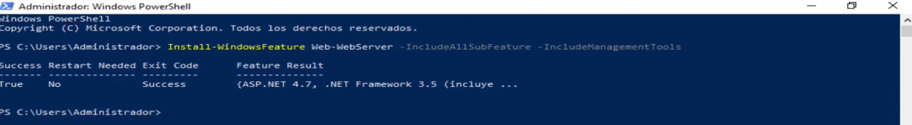
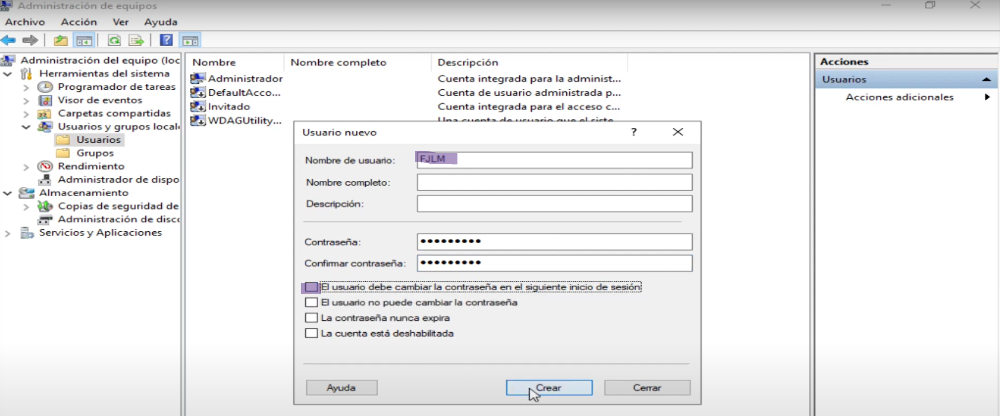
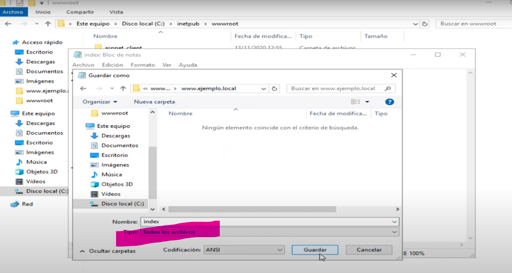
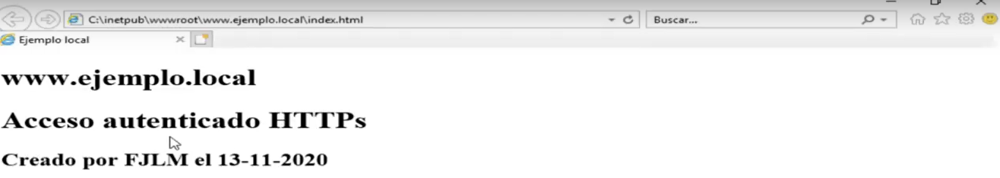
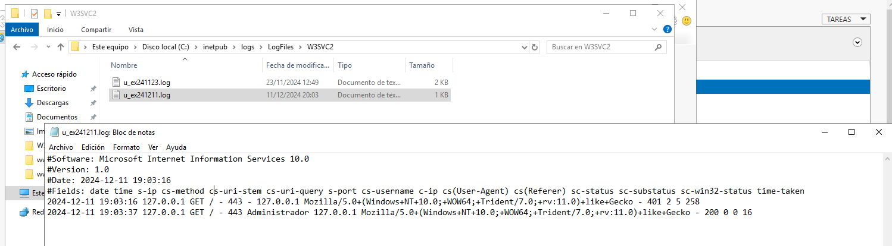

- [Guion para la Instalación de un Servidor Web en Windows Server 2019](#guion-para-la-instalación-de-un-servidor-web-en-windows-server-2019)
    - [1. Instalar IIS con PowerShell](#1-instalar-iis-con-powershell)
    - [2. Crear un Usuario de Windows](#2-crear-un-usuario-de-windows)
    - [3. Crear Directorios para los Sitios Web en wwwroot](#3-crear-directorios-para-los-sitios-web-en-wwwroot)
    - [4. Crear Archivos HTML para Cada Sitio Web](#4-crear-archivos-html-para-cada-sitio-web)
    - [5. Crear un Certificado Autofirmado ***para el Sitio con Seguridad***](#5-crear-un-certificado-autofirmado-para-el-sitio-con-seguridad)
    - [6. Crear el Sitio Web HTTPS en IIS](#6-crear-el-sitio-web-https-en-iis)
    - [7. Crear el Sitio Web HTTP en IIS](#7-crear-el-sitio-web-http-en-iis)
    - [8. Configurar Autenticación para HTTPS (sitio1.local)](#8-configurar-autenticación-para-https-sitio1local)
    - [9. Configurar Autenticación para HTTP (sitio2.net)](#9-configurar-autenticación-para-http-sitio2net)
    - [10. Modificar el Archivo de Hosts](#10-modificar-el-archivo-de-hosts)
    - [11. Pruebas de Conexión](#11-pruebas-de-conexión)
      - [**11.1. Pruebas con navegador web**](#111-pruebas-con-navegador-web)
      - [**11.2. Pruebas desde otro cliente de la red**](#112-pruebas-desde-otro-cliente-de-la-red)
        - [**a) Comprobación de resolución de nombres**](#a-comprobación-de-resolución-de-nombres)
        - [**b) Pruebas con navegador desde el otro equipo**](#b-pruebas-con-navegador-desde-el-otro-equipo)
    - [12. Comprobar el registro de conexiones](#12-comprobar-el-registro-de-conexiones)
    - [QUÉ DEBO ENTREGAR 📸:](#qué-debo-entregar-)

# Guion para la Instalación de un Servidor Web en Windows Server 2019

### 1. Instalar IIS con PowerShell
   - Abre PowerShell como administrador.
   - Ejecuta el siguiente comando para instalar el servidor web (IIS):
     ```powershell
     Install-WindowsFeature -Name Web-Server,Web-Basic-Auth -IncludeManagementTools
     ```
   - Comprueba que el resultado de la instalación es correcto. Ejecuta el siguiente comando para reiniciar el servidor web (IIS):
     ```powershell
     iisreset
     ```


> La captura muestra una instalación con más componentes. El comando de esta práctica instala IIS y la autenticación básica.

   - Abre `http://localhost` en el servidor y comprueba que se muestra la página inicial de IIS. Después, en el Administrador de IIS, selecciona **Sitios → Default Web Site → Detener**. Así evitas que el sitio predeterminado sirva por HTTP los archivos que vas a guardar en `wwwroot` para el sitio protegido.

### 2. Crear un Usuario de Windows
   - Abre **Administración de Equipos**.
   - Ve a **Usuarios y Grupos Locales** y crea un nuevo usuario con tus INICIALES.
   - Establece una contraseña para la práctica y deja al usuario como cuenta local estándar, sin permisos de administrador ni cambio de contraseña obligatorio en el siguiente inicio.
  

### 3. Crear Directorios para los Sitios Web en wwwroot
   - Abre el explorador de archivos y navega a la carpeta `C:\inetpub\wwwroot`.
   - Crea dos subdirectorios dentro de `wwwroot`: `sitio1` y `sitio2`.

### 4. Crear Archivos HTML para Cada Sitio Web

(**Como alternativa más sencilla, puedes copiar los archivos en VSC y subirlos al servidor mediante FTP**)

> Utilizando el bloc de notas

   - En la carpeta `sitio1`, crea un archivo llamado `index.html` con el siguiente contenido:
     ```html
        <!DOCTYPE html>
        <html lang="en">
        <head>
            <meta charset="UTF-8">
            <meta name="viewport" content="width=device-width, initial-scale=1.0">
            <title>AUTENTICADO</title>
        </head>
        <body>
            <h1>www.INICIALES.local</h1>
            <h1>ACCESO AUTENTICADO con https</h1>
            <h1>Creado por: <strong>INICIALES</strong> el <em>fecha actual</em></h1>
        </body>
        </html>
     ```

> Debes seleccionar **Todos los archivos** cuando guardes el documento.



> Comprueba que el archivo aparece con un icono de internet explores y que, al abrirlo, el navedador lo renderiza adecuadamente




   - Repite el proceso en la carpeta `sitio2`, creando otro `index.html` con el siguiente contenido:
     ```html
        <!DOCTYPE html>
        <html lang="en">
        <head>
            <meta charset="UTF-8">
            <meta name="viewport" content="width=device-width, initial-scale=1.0">
            <title>ANÓNIMO</title>
        </head>
        <body>
            <h1>www.INICIALES.net</h1>
            <h1>ACCESO <strong>ANÓNIMO</strong> con http</h1>
            <h1>Creado por: <strong>INICIALES</strong> el <em>fecha actual</em></h1>
        </body>
        </html>
     ```

### 5. Crear un Certificado Autofirmado ***para el Sitio con Seguridad***
(Solo se utilizará para configurar el sitio HTTPS)
```powershell
New-SelfSignedCertificate -DnsName "www.sitio1.local","sitio1.local" -CertStoreLocation "cert:\LocalMachine\My"
```

### 6. Crear el Sitio Web HTTPS en IIS
   - En **Administrador de IIS**, haz clic derecho sobre **Sitios** y selecciona **Agregar sitio web**.
   - Introduce los siguientes detalles:
     - **Nombre del Sitio**: `sitio1`
     - **Ruta Física**: `C:\inetpub\wwwroot\sitio1` (la que corresponda a tu equipo)
     - **Tipo**: `https`
     - **IP**: `All Unassigned`
     - **Puerto**: `443`
     - **Host name**: `sitio1.local`
     - Marca **Requerir indicación de nombre de servidor (SNI)**.
     - Asocia el certificado autofirmado creado previamente.


### 7. Crear el Sitio Web HTTP en IIS
   - Haz clic derecho sobre **Sitios** y selecciona **Agregar sitio web**.
   - Introduce los siguientes detalles:
     - **Nombre del Sitio**: `sitio2`
     - **Ruta Física**: `C:\inetpub\wwwroot\sitio2` (la que corresponda a tu equipo)
     - **Tipo**: `http`
     - **IP**: `All Unassigned`
     - **Puerto**: `80`
     - **Host name**: `sitio2.net`


### 8. Configurar Autenticación para HTTPS (sitio1.local)
   - Selecciona `sitio1` en **Administrador de IIS**.
   - Haz clic en **Autenticación** y desactiva **Autenticación Anónima**.
   - Activa **Autenticación básica**. En las pruebas, usa la cuenta local que creaste en el paso 2.


### 9. Configurar Autenticación para HTTP (sitio2.net)
   - Selecciona `sitio2` en **Administrador de IIS**.
   - Haz clic en **Autenticación** y asegúrate de que **Autenticación Anónima** esté activada, permitiendo acceso público sin necesidad de credenciales.


### 10. Modificar el Archivo de Hosts
   - En el **servidor**, abre el archivo `hosts` ubicado en `C:\Windows\System32\drivers\etc\hosts` con **permisos de administrador**.
   - Añade las siguientes líneas: (con los nombres de host que correspondan a tu escenario)
     ```plaintext
     127.0.0.1   sitio1.local 
     127.0.0.1   sitio2.net
     ```
   - ASEGÚRATE DE QUITAR LAS # DEL PRINCIPIO DE LÍNEA (descomentar)


### 11. Pruebas de Conexión

#### **11.1. Pruebas con navegador web**

Ahora comprueba el funcionamiento desde el propio servidor utilizando un navegador.

**a) Acceso a `https://sitio1.local`**

* Comprueba que la dirección usa HTTPS y que el certificado incluye `sitio1.local` entre sus nombres válidos.
* Si el navegador avisa de que el certificado autofirmado no es de confianza, compara su huella con la del certificado asignado en IIS. Puedes consultar la huella en **Certificados del servidor** en IIS, en la pestaña **Detalles** del certificado. Usa el mismo algoritmo en ambas consultas. Si el nombre o la huella difieren, corrige el certificado, el enlace o la URL antes de introducir credenciales.
* Si el navegador de laboratorio bloquea el acceso por falta de confianza, exporta solo el certificado público del servidor (`.cer`, sin clave privada). Una vez verificada la huella, impórtalo en el almacén de confianza del cliente de laboratorio. En Windows, usa **Entidades de certificación raíz de confianza** del usuario actual. Vuelve a abrir el sitio.
* Accede con la cuenta que creaste usando el formato `NOMBRE_DEL_SERVIDOR\usuario` y comprueba que se muestra la página del sitio1.

**b) Acceso a `http://sitio2.net`**

* Debe mostrarse directamente la página del sitio2 sin pedir credenciales.
* Debes comprobar que el contenido coincide con el HTML que creaste.

> Algunas de las capturas siguientes muestran un error de nombre del certificado. Si aparece durante tu prueba, corrígelo antes de continuar.


#### **11.2. Pruebas desde otro cliente de la red**

Repite las pruebas desde **otro equipo con acceso a la red de laboratorio del servidor**. En VirtualBox, si el cliente es otra máquina virtual, podéis usar la misma **Red interna** o la misma red **Solo anfitrión**. Si el cliente es el equipo anfitrión, usa **Solo anfitrión**. En el archivo de nombres del cliente usa la IP del servidor en esa red.

##### **a) Comprobación de resolución de nombres**

En el archivo `hosts` del **equipo cliente**, asocia `sitio1.local` y `sitio2.net` a la IP de la máquina virtual servidora. Usa los mismos nombres que en el paso 10 y sustituye `127.0.0.1` por esa IP en ambas entradas.

Ejecuta en el cliente:

```cmd
ping sitio1.local
ping sitio2.net
```

* Deben resolver a la IP del servidor.
* Para esta comprobación, fíjate en la IP que muestra el comando. El firewall puede bloquear la respuesta al ping.

##### **b) Pruebas con navegador desde el otro equipo**

**Acceso HTTPS autenticado:**

* Abre `https://sitio1.local` y comprueba la conexión HTTPS y el certificado como en el paso 11.1.
* Verifica que solicita credenciales. Entra como `NOMBRE_DEL_SERVIDOR\usuario` y comprueba que se muestra la página del sitio1.

**Acceso HTTP anónimo:**

* Abrir `http://sitio2.net`
* Ver la página sin autenticación.

**Si funciona en el servidor y falla desde el cliente**, comprueba la conexión a los puertos web. Desde un cliente Windows, ejecuta en PowerShell:

```powershell
Test-NetConnection sitio2.net -Port 80
Test-NetConnection sitio1.local -Port 443
```

Si `TcpTestSucceeded` es `False`, revisa que el nombre resuelve a la IP correcta, que los equipos comparten la red de laboratorio y que las reglas de entrada permiten los puertos TCP 80 y 443 para esa red en el perfil activo del firewall del servidor.

### 12. Comprobar el registro de conexiones

En el directorio `C:\inetpub\logs\LogFiles` encontrarás los archivos de log agrupados por identificador del sitio (`W3SVC` seguido del ID) y fecha.




1. **Navegar a la carpeta:**
   - Ve a la ruta identificada (por defecto `C:\inetpub\logs\LogFiles`).

2. **Abrir el archivo de log más reciente:**
   - Busca los archivos con nombres como `u_exYYYYMMDD.log`, donde `YYYYMMDD` representa la fecha.

3. **Interpretar los encabezados del log:**
   Los archivos están en formato **W3C** y contienen columnas clave:
   - **`date`**: Fecha de la solicitud (formato AAAA-MM-DD).
   - **`time`**: Hora exacta de la solicitud (formato HH:MM:SS en UTC).
   - **`c-ip`**: Dirección IP del cliente que realizó la solicitud.
   - **`cs-method`**: Método HTTP utilizado (como GET, POST, etc.).
   - **`cs-uri-stem`**: Recurso solicitado (por ejemplo, `/index.html` o `/api/data`).
   - **`sc-status`**: Código de estado HTTP de la respuesta (200 para éxito, 404 para no encontrado, etc.).
   - **`sc-bytes`**: Número de bytes enviados al cliente.
   - **`cs-bytes`**: Número de bytes recibidos del cliente.
   - **`time-taken`**: Tiempo (en milisegundos) que el servidor tardó en procesar la solicitud.

---

### QUÉ DEBO ENTREGAR 📸: 

Una documento pdf con las siguientes capturas:

---

**Certificado autofirmado**

**1.** Captura del **Administrador de IIS → Certificados del servidor** mostrando el certificado autofirmado creado.


---

**Sitio HTTPS**

**2.** Captura de la ventana **Agregar sitio web** del `sitio1`, donde se vea:

* Puerto 443
* Tipo HTTPS
* Host `sitio1.local`
* Certificado asignado
* Ruta física correcta


**3.** Captura del sitio `sitio1` ya creado y visible en la lista de sitios de IIS.


---

**sitio HTTP**

**4.** Captura de la ventana **Agregar sitio web** del `sitio2`, donde se vea:

* Puerto 80
* Tipo HTTP
* Host `sitio2.net`
* Ruta física correcta


**5.** Captura del sitio `sitio2` ya creado y visible en la lista de sitios de IIS.


---

**Pruebas con navegador (servidor)**

**6.** Captura del navegador accediendo a `https://sitio1.local` mostrando **el cuadro de autenticación**.


**7.** Captura del navegador mostrando la página **tras autenticarse** en `sitio1`.


**8.** Captura del navegador accediendo a `http://sitio2.net` mostrando la página sin autenticación.


---

**Pruebas desde otro cliente**

(PC, máquina virtual o cualquier otro equipo de la red)

**9.** Captura de `ping sitio1.local` y `ping sitio2.net` mostrando que resuelven el nombre.


**10.** Captura del navegador desde otro equipo accediendo a `https://sitio1.local`.

**11.** Captura del navegador desde otro equipo accediendo a `http://sitio2.net`.

---

**Logs del servidor web**

**12.** Captura del registro de IIS donde se vea una petición `GET` de tu prueba desde el cliente, con su IP (`c-ip`), el recurso (`cs-uri-stem`) y el estado (`sc-status`). Acompaña la captura con una frase que indique qué pidió el navegador y qué significa el código que devolvió IIS.
