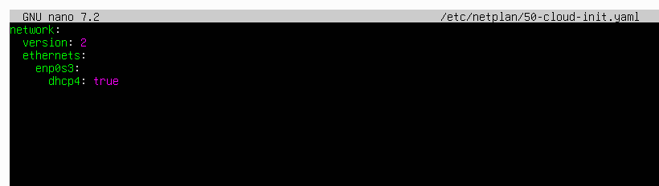
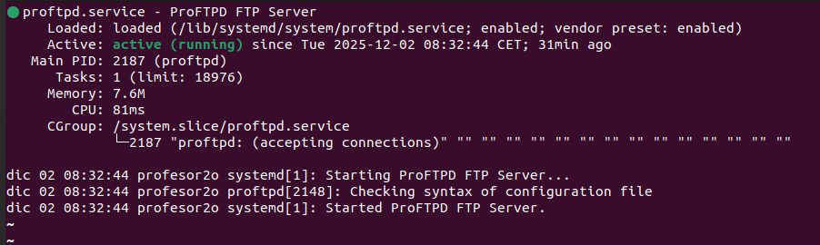
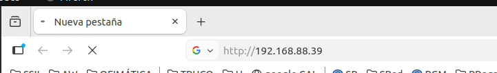
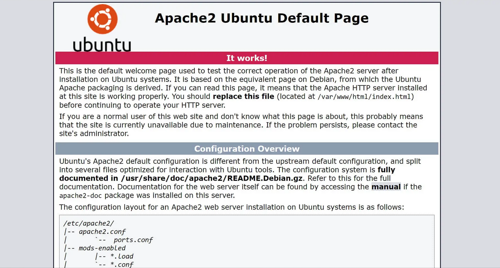
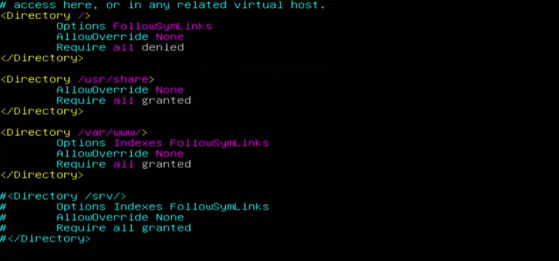
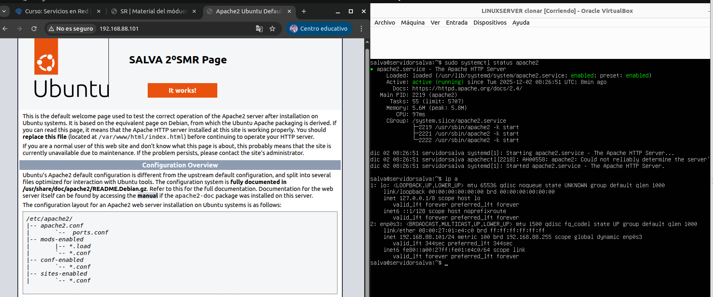
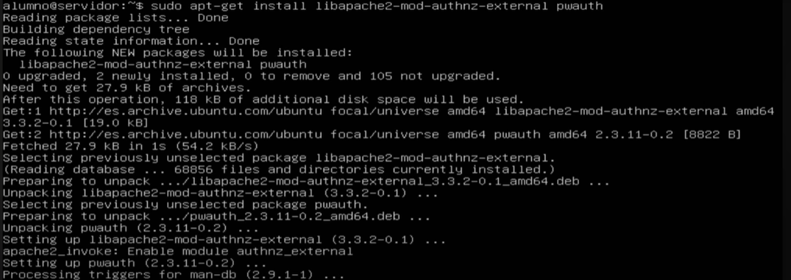
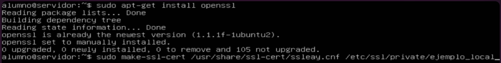
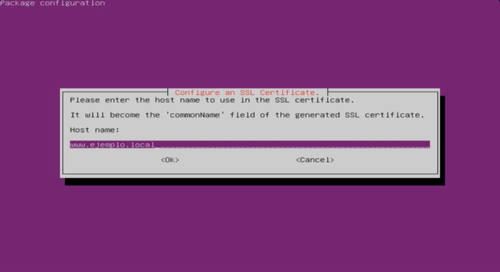

- [📝 **Guion para la práctica: Instalación de Apache y configuración de dos sitios virtuales en Ubuntu Server**](#-guion-para-la-práctica-instalación-de-apache-y-configuración-de-dos-sitios-virtuales-en-ubuntu-server)
- [**PARTE 1 — Instalación de Apache y personalización del sitio por defecto**](#parte-1--instalación-de-apache-y-personalización-del-sitio-por-defecto)
  - [1. **Configuración previa de red en la máquina virtual**](#1-configuración-previa-de-red-en-la-máquina-virtual)
    - [1.1. **Configuración de red por DHCP (modo puente en VirtualBox)**](#11-configuración-de-red-por-dhcp-modo-puente-en-virtualbox)
  - [2. **Instalación del servidor web Apache**](#2-instalación-del-servidor-web-apache)
  - [3. **Comprobación del servicio**](#3-comprobación-del-servicio)
  - [Aquí tienes más información sobre la configuración de apache](#aquí-tienes-más-información-sobre-la-configuración-de-apache)
  - [4. **Personalización del sitio por defecto**](#4-personalización-del-sitio-por-defecto)
- [**PARTE 2 — Convivencia de dos sitios virtuales**](#parte-2--convivencia-de-dos-sitios-virtuales)
- [**PARTE 2a — Sitio con acceso anónimo (HTTP)**](#parte-2a--sitio-con-acceso-anónimo-http)
  - [5. **Creación del directorio y contenido del sitio anónimo**](#5-creación-del-directorio-y-contenido-del-sitio-anónimo)
  - [6. **Creación del VirtualHost del sitio anónimo**](#6-creación-del-virtualhost-del-sitio-anónimo)
  - [7. **Habilitar este sitio y desactivar el sitio por defecto**](#7-habilitar-este-sitio-y-desactivar-el-sitio-por-defecto)
- [**PARTE 2b — Sitio con acceso autenticado y HTTPS**](#parte-2b--sitio-con-acceso-autenticado-y-https)
  - [8. **Creación del directorio y contenido del sitio autenticado**](#8-creación-del-directorio-y-contenido-del-sitio-autenticado)
  - [9. **Instalación de módulos de autenticación externa**](#9-instalación-de-módulos-de-autenticación-externa)
  - [10. **Creación del certificado digital autofirmado**](#10-creación-del-certificado-digital-autofirmado)
  - [11. **Creación del sitio autenticado (HTTPS + Basic Auth + pwauth)**](#11-creación-del-sitio-autenticado-https--basic-auth--pwauth)
  - [12. **Habilitar el sitio autenticado**](#12-habilitar-el-sitio-autenticado)
  - [13. **Consulta de sitios y comprobación de errores**](#13-consulta-de-sitios-y-comprobación-de-errores)
  - [14. **Configuración del archivo hosts en el cliente**](#14-configuración-del-archivo-hosts-en-el-cliente)
  - [15. **Conexión desde cliente web con un navegador moderno**](#15-conexión-desde-cliente-web-con-un-navegador-moderno)
  - [16. **Revisión de logs de Apache**](#16-revisión-de-logs-de-apache)
  - [ENTREGAS:](#entregas)
  - [17. **Restaurar la configuración de red original**](#17-restaurar-la-configuración-de-red-original)


# 📝 **Guion para la práctica: Instalación de Apache y configuración de dos sitios virtuales en Ubuntu Server**

---

# **PARTE 1 — Instalación de Apache y personalización del sitio por defecto**

---

## 1. **Configuración previa de red en la máquina virtual**

Antes de instalar Apache, prepara la conexión entre Ubuntu Server y el equipo cliente. Para esta práctica se recomienda **modo puente con DHCP y administración por SSH desde el equipo físico**. Ese equipo servirá también como cliente web.

La guía [Comprobar conectividad y SSH](../../UT01B/05_comprobar_conectividad_y_ssh.md) explica la preparación inicial del clon y las tres formas de trabajo disponibles. Si ya tienes una conexión operativa, comprueba el acceso al servidor y a los repositorios y continúa con el paso 2.

### 1.1. **Configuración de red por DHCP (modo puente en VirtualBox)**

1. Anota la configuración original y guarda la copia de Netplan siguiendo [Antes de cambiar la red](../../UT01B/05_comprobar_conectividad_y_ssh.md#antes-de-cambiar-la-red). Conserva esa copia para el paso 17 si el cambio es temporal.
2. Configura el adaptador puente y DHCP siguiendo [Puente y SSH](../../UT01B/05_comprobar_conectividad_y_ssh.md#puente-y-ssh).
3. Instala o comprueba SSH y abre la conexión desde el equipo físico siguiendo el [apartado de SSH](../../UT01B/05_comprobar_conectividad_y_ssh.md#3-comprobar-ssh).
4. Anota la IP del servidor que alcanza el cliente. Utiliza esa IP en SSH y en las pruebas web.

La captura siguiente muestra un ejemplo de DHCP en Netplan. Adapta el nombre de interfaz a tu máquina.



En los pasos 7 y 14, modifica el archivo `hosts` del **equipo físico**, donde abrirás el navegador. Asocia `sitio1.local` y `sitio2.local` a la IP del servidor.

---

## 2. **Instalación del servidor web Apache**

```bash
sudo apt update
sudo apt install apache2 -y
```

---

## 3. **Comprobación del servicio**

Verifica que Apache está instalado:

```bash
ls /etc/apache2
sudo systemctl status apache2
```


Accede al sitio por defecto a través del navedador:



Revisa el archivo de configuración GENERAL DE **APACHE**:

```
sudo nano /etc/apache2/apache2.conf
```



[Aquí tienes más información sobre la configuración de apache](../../SR05WEB/SR0506_config_apache2.md)
---

## 4. **Personalización del sitio por defecto**

El sitio por defecto se sirve desde:

```
/var/www/html/index.html
```
El archivo anterior contiene el código html con el contenido de la página web incial del sitio.

Haz una copia:

```bash
sudo cp /var/www/html/index.html /var/www/html/index.html.ORIGINAL
```

Edita:

```bash
sudo nano /var/www/html/index.html
```

Añade tu nombre, fecha o un mensaje personalizado para comprobar el funcionamiento.

> Entrega una captura similar a esta:




# **PARTE 2 — Convivencia de dos sitios virtuales**

En esta segunda parte crearás **dos sitios web**:

* **Sitio 1 (HTTP, acceso anónimo)**
* **Sitio 2 (HTTPS, acceso autenticado)**

Ambos coexistirán en el mismo servidor Apache.

---

# **PARTE 2a — Sitio con acceso anónimo (HTTP)**

---

## 5. **Creación del directorio y contenido del sitio anónimo**

Creamos la raíz del sitio:

```bash
sudo mkdir -p /var/www/sitio1
```

Creamos su página principal:

```bash
sudo nano /var/www/sitio1/index.html
```

Contenido sugerido:

```html
<!DOCTYPE html>
<html lang="es">
<head>
    <meta charset="UTF-8">
    <title>Sitio Anónimo</title>
</head>
<body>
    <h1>Sitio con acceso anónimo</h1>
    <p>Alumno: [Nombre]</p>
    <p>Fecha: [Fecha]</p>
</body>
</html>
```

---

## 6. **Creación del VirtualHost del sitio anónimo**

Creamos el archivo:

```bash
sudo nano /etc/apache2/sites-available/sitio1.conf
```
El archivo anterior es una archivo de configuración de apache. En él se indican las características básicas de nuestro sitio web.

Contenido:

```apache
<VirtualHost *:80>
    ServerName sitio1.local
    ServerAdmin admin@sitio1.local

    DocumentRoot /var/www/sitio1

    <Directory /var/www/sitio1>
        Require all granted
    </Directory>
</VirtualHost>
```

---

## 7. **Habilitar este sitio y desactivar el sitio por defecto**

Activa `sitio1.conf` y mantén `000-default.conf` activo hasta completar la prueba de selección por nombre.

```bash
sudo a2ensite sitio1.conf
sudo apache2ctl configtest && sudo systemctl reload apache2
```

Si Apache está detenido y la sintaxis es correcta, inícialo con `sudo systemctl start apache2`. Comprueba el estado con `sudo systemctl status apache2`.

En el archivo `hosts` del **cliente**, asocia `sitio1.local` con la IP del servidor. En el paso 14 tienes la ruta del archivo en Linux y Windows. Desde el navegador del cliente, abre estas dos direcciones:

- `http://IP_DEL_SERVIDOR/` muestra la página predeterminada que personalizaste.
- `http://sitio1.local/` muestra la página del sitio anónimo que creaste en el paso 5.

Ambas peticiones llegan a la misma IP y al puerto 80. Comprueba qué sitio está configurado por defecto con `sudo apache2ctl -S`.

> Entrega dos capturas:
> 1. Archivo de configuración del sitio.
> 2. Servidor con `systemctl status` y su IP, y las dos páginas abiertas desde el cliente. Deja visibles las direcciones para que se pueda comparar la selección por IP y por nombre.

Después de la prueba, desactiva el sitio predeterminado y comprueba que `http://sitio1.local/` sigue mostrando la página del sitio anónimo.

```bash
sudo a2dissite 000-default.conf
sudo apache2ctl configtest && sudo systemctl reload apache2
```

# **PARTE 2b — Sitio con acceso autenticado y HTTPS**

---

## 8. **Creación del directorio y contenido del sitio autenticado**

```bash
sudo mkdir -p /var/www/sitio2
sudo nano /var/www/sitio2/index.html
```

Contenido:

```html
<!DOCTYPE html>
<html lang="es">
<head>
    <meta charset="UTF-8">
    <title>Sitio Autenticado</title>
</head>
<body>
    <h1>Sitio con acceso autenticado</h1>
    <p>Alumno: [Nombre]</p>
    <p>Fecha: [Fecha]</p>
</body>
</html>
```

---

## 9. **Instalación de módulos de autenticación externa**

```bash
sudo apt install libapache2-mod-authnz-external pwauth -y
```



Activa módulos:

```bash
sudo a2enmod auth_basic
sudo a2enmod authnz_external
```


Crea un usuario local para probar:

```bash
sudo adduser usuario1
```

---

## 10. **Creación del certificado digital autofirmado**

Instala el paquete `ssl-cert`, que proporciona `make-ssl-cert`.

```bash
sudo apt install ssl-cert -y
```

Genera certificado autofirmado usando el método clásico de Ubuntu:

```bash
sudo make-ssl-cert /usr/share/ssl-cert/ssleay.cnf /etc/ssl/private/sitio2_cert
```

Escribe `sitio2.local` como nombre de host. Si se solicitan nombres alternativos, incluye `DNS:sitio2.local`. Comprueba que el certificado incluye `sitio2.local` entre sus nombres DNS y anota su huella SHA-256 para verificarlo en el cliente.

```bash
sudo openssl x509 -in /etc/ssl/private/sitio2_cert -noout -ext subjectAltName -sha256 -fingerprint
```

> Las capturas ilustran el procedimiento con un nombre de ejemplo. Usa `sitio2.local` en tu configuración.




Activa SSL:

```bash
sudo a2enmod ssl
```


---

## 11. **Creación del sitio autenticado (HTTPS + Basic Auth + pwauth)**

Archivo:

```bash
sudo nano /etc/apache2/sites-available/sitio2.conf
```

Contenido:

```apache
<VirtualHost *:443>
    ServerName sitio2.local
    ServerAdmin admin@sitio2.local

    DocumentRoot /var/www/sitio2

    # Autenticación con pwauth
    DefineExternalAuth pwauth pipe /usr/sbin/pwauth

    <Directory "/var/www/sitio2">
        AuthType Basic
        AuthName "Sitio protegido - Introduzca usuario y clave"
        AuthBasicProvider external
        AuthExternal pwauth
        Require valid-user
    </Directory>

    # Activación SSL
    SSLEngine on
    SSLCertificateFile /etc/ssl/private/sitio2_cert
</VirtualHost>
```

> La captura muestra una configuración de ejemplo. Usa el nombre y la ruta del certificado indicados en el bloque anterior.


---

## 12. **Habilitar el sitio autenticado**

```bash
sudo a2ensite sitio2.conf
sudo apache2ctl configtest && sudo systemctl reload apache2
```

Verifica:

```bash
sudo apache2ctl -M
```

Comprueba que aparecen `authnz_external_module` y `ssl_module`.

---

## 13. **Consulta de sitios y comprobación de errores**

Consultar sitios disponibles:

```
ls /etc/apache2/sites-available
```

En caso de error:

```bash
journalctl -xe
```


---

## 14. **Configuración del archivo hosts en el cliente**

En Linux:

```bash
sudo nano /etc/hosts
```

En Windows:

Editar:

```
C:\Windows\System32\drivers\etc\hosts
```

Conserva la entrada de `sitio1.local` que añadiste en el paso 7 y añade la de `sitio2.local`. Los dos nombres deben apuntar a la IP del servidor que alcanza el cliente.

```
[IP] sitio1.local
[IP] sitio2.local
```

---

## 15. **Conexión desde cliente web con un navegador moderno**

Accede a tus sitios desde un navegador en un cliente que esté en la misma red.

- Abre `http://sitio1.local/` y comprueba que se muestra el sitio anónimo.
- Abre `https://sitio2.local/` y comprueba que el certificado corresponde a ese nombre. Si aparece un aviso de confianza por ser autofirmado, compara su huella con la anotada en el paso 10. Corrige cualquier discrepancia antes de introducir credenciales.
- Verifica que el sitio HTTPS solicita credenciales. Accede con el usuario creado en el paso 9 y comprueba que se muestra la página del sitio autenticado.

---

## 16. **Revisión de logs de Apache**

Consulta el registro de acceso que esté configurado. Si se usa el registro común de sitios virtuales, abre `/var/log/apache2/other_vhosts_access.log`. Busca la petición que hiciste desde el cliente.

[ampliacion](../../SR05WEB/SR0504_USwebLog.md)

## ENTREGAS:

> **Entrega seis capturas:**
> 
> 1. Parte 1 - 4: captura del sitio original modificado.
> 
> 2. Archivo de configuración del sitio cifrado y salida de `apache2ctl -M` donde se vean los módulos de autenticación externa y SSL.
> 
> 3. Parte 2a - 7: Archivo de configuración del sitio 1
> 
> 4. Parte 2a - 7: Servidor con `systemctl status` y su IP, y las dos páginas abiertas desde el cliente. Deja visibles las direcciones en el navegador para que se pueda comparar la selección por IP y por nombre.
> 
> 5. Acceso al sitio desde un cliente en la misma red (a un lado el servidor, con `systemctl status` y mostrando la ip y, al otro lado, el acceso desde un navegador del cliente y mostrando la ip)
> 
> 6. Contenido del log de apache con los registros más recientes, en el que se vea la conexión desde el cliente de la captura anterior.


## 17. **Restaurar la configuración de red original**

Si cambiaste temporalmente la red en el paso 1.1, recupera la configuración original del adaptador en VirtualBox al terminar las pruebas. En la consola de la máquina virtual, restaura **la misma copia del archivo de Netplan** que guardaste al inicio. Sustituye `archivo-real.yaml` por el nombre que usaste.

```bash
sudo cp /etc/netplan/archivo-real.yaml.ORIGINAL /etc/netplan/archivo-real.yaml
sudo netplan apply
ip -br a
```

Comprueba que la máquina recupera la IP y la conectividad de la red original. Si cambia la IP del servidor, actualiza las dos entradas del archivo `hosts` del cliente.
