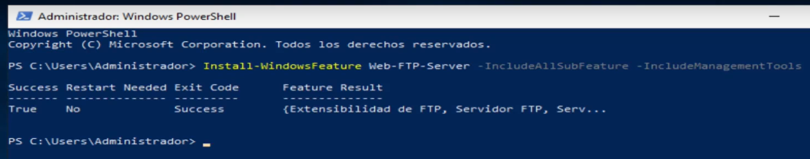
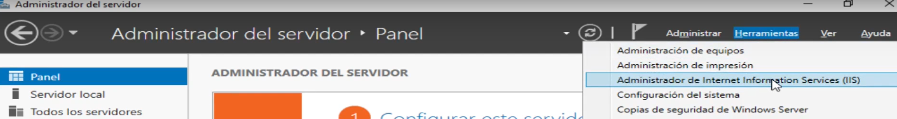
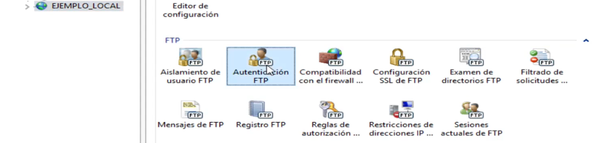

# 0401 · FTP Windows: instalación básica

[Escenario de trabajo](#escenario-de-trabajo) · [1. Preparar el servidor](#1-preparar-el-servidor) · [2. Instalar FTP e IIS](#2-instalar-ftp-e-iis) · [3. Preparar la cuenta y las carpetas](#3-preparar-la-cuenta-y-las-carpetas) · [4. Crear el sitio FTP](#4-crear-el-sitio-ftp) · [5. Comprobar el servicio desde el servidor](#5-comprobar-el-servicio-desde-el-servidor) · [Qué debes entregar](#qué-debes-entregar) · [Cómo se valorará](#cómo-se-valorará)

## Objetivo de la práctica

La empresa necesita un lugar donde intercambiar archivos. Instala un servidor FTP en **Windows Server 2019**, publica una carpeta y comprueba que una cuenta de laboratorio puede listar, subir y descargar archivos.

El mismo servidor continuará en las siguientes prácticas. Conserva sus archivos y su configuración.

## Escenario de trabajo

| Elemento | Configuración |
|---|---|
| Servidor | Windows Server 2019 con Experiencia de escritorio, nombre `FTP-SRV` |
| IP del servidor | `192.168.4.10`, máscara `255.255.255.0` |
| Cliente para las siguientes prácticas | Otra VM Windows, nombre `FTP-CLI`, IP `192.168.4.20/24` |
| Red de ambas VM | Red interna de VirtualBox `SR-FTP` |
| Puerta de enlace y DNS | En blanco: las pruebas utilizan IP y no necesitan salida de esta red |
| Sitio FTP | `FTP_EMPRESA`, puerto `21`, sin nombre de host virtual |
| Carpeta publicada | `C:\FTP\Empresa` |
| Cuenta FTP | Usuario local `ftpbase`, sin privilegios de administrador |

Utiliza **clones de trabajo**, conservando las máquinas de otras prácticas y sus instantáneas. Si partes de una VM que ya tiene DNS u otro servicio, prepara un clon para FTP; no cambies la máquina que necesitas conservar.

> En este laboratorio usaremos FTP sin TLS dentro de una red interna aislada, con una contraseña exclusiva de prueba. FTP convencional no cifra las credenciales ni los archivos. No utilices contraseñas personales ni conectes el laboratorio en modo puente durante las pruebas.

## 1. Preparar el servidor

1. Con la VM apagada, abre **VirtualBox → Configuración → Red**. Conecta el adaptador de trabajo a **Red interna** y escribe `SR-FTP`. Deshabilita los otros adaptadores durante las pruebas.
2. Inicia Windows Server. En **Administrador del servidor → Servidor local → Nombre de equipo → Cambiar**, establece `FTP-SRV` si aún tiene otro nombre. Reinicia cuando lo solicite.
3. Abre **Panel de control → Centro de redes y recursos compartidos → Cambiar configuración del adaptador**. En las propiedades de **Ethernet → Protocolo de Internet versión 4**, configura la IP y máscara de la tabla. Deja puerta de enlace y DNS en blanco.
4. Abre PowerShell y comprueba:

   ```powershell
   hostname
   ipconfig
   ```

**Comprueba:** la interfaz utilizada tiene `192.168.4.10/24`. En las pruebas locales de esta práctica, servidor y cliente FTP se ejecutarán en esta misma VM. El otro equipo se utilizará en 0402.

📸 **Captura 1:** nombre e IP del servidor, visibles y legibles.

## 2. Instalar FTP e IIS

Abre **Windows PowerShell como administrador dentro del servidor** y ejecuta:

```powershell
Install-WindowsFeature -Name Web-Server,Web-FTP-Server,Web-Mgmt-Console -IncludeManagementTools
```



Las imágenes proceden del laboratorio anterior: usa los nombres y rutas de este guion, aunque los ejemplos de las capturas sean distintos.

Comprueba los componentes y el servicio:

```powershell
Get-WindowsFeature -Name Web-Server,Web-FTP-Server,Web-Mgmt-Console
Get-Service -Name FTPSVC
```

Los componentes deben aparecer instalados. Si `FTPSVC` existe pero está detenido, inícialo:

```powershell
Start-Service -Name FTPSVC
```

**Comprueba:** el servicio aparece en estado `Running`.

> La instalación puede utilizar los archivos de características disponibles en Windows. Si solicita un origen que no encuentra, conserva el mensaje y consulta al profesor. Si hay que descargar componentes, se preparará temporalmente la VM con NAT y se devolverá a `SR-FTP` antes de continuar. No cambies al modo puente ni inventes una puerta de enlace para la red interna.

## 3. Preparar la cuenta y las carpetas

### 3.1. Crear una cuenta exclusiva de laboratorio

1. Abre **Administrador del servidor → Herramientas → Administración de equipos**.
2. Accede a **Usuarios y grupos locales → Usuarios → Usuario nuevo**.
3. Crea `ftpbase` con una contraseña exclusiva de laboratorio que cumpla la complejidad exigida por Windows.
4. Desmarca **El usuario debe cambiar la contraseña en el siguiente inicio de sesión**. Comprueba que la cuenta está habilitada y que no pertenece a **Administradores**.

Conserva la contraseña para las siguientes prácticas. **No la incluyas en la memoria ni en las capturas.**

### 3.2. Preparar la carpeta que publicará el servidor

1. En el Explorador crea `C:\FTP\Empresa`.
2. Dentro, crea `bienvenida.txt`, con una frase que identifique tu servidor.
3. En **Vista**, activa **Extensiones de nombre de archivo**. Comprueba que el archivo no se llama `bienvenida.txt.txt`.
4. Abre **Propiedades de Empresa → Seguridad → Editar → Agregar**. Selecciona la ubicación `FTP-SRV` y añade el usuario local `ftpbase`.
5. Concede a `ftpbase` **Modificar**. Conserva las entradas de administración del sistema.

**Comprueba:** has concedido permiso sobre la carpeta publicada. Después habrá que permitir también el acceso en el servicio FTP: ambas configuraciones deben ser coherentes.

### 3.3. Preparar una carpeta para actuar como cliente

Crea **otra carpeta**, `C:\FTP_PRUEBAS`, y dentro `subida0401.txt` con una frase diferente.

Aunque todo esté en la misma VM, `C:\FTP\Empresa` será la carpeta del **servidor** y `C:\FTP_PRUEBAS` la carpeta local del **cliente FTP**. Así podremos observar en qué sentido se mueve cada archivo.

## 4. Crear el sitio FTP

1. Abre **Administrador del servidor → Herramientas → Administrador de Internet Information Services (IIS)**.
2. Despliega el servidor. Si ya existen sitios FTP en el clon, comprueba con el profesor qué configuración debes conservar antes de crear otro en el puerto 21. Pulsa con el botón derecho en **Sitios → Agregar sitio FTP**.



3. Completa el asistente:

   | Opción | Valor |
   |---|---|
   | Nombre del sitio FTP | `FTP_EMPRESA` |
   | Ruta de acceso física | `C:\FTP\Empresa` |
   | Dirección IP | **Todas las no asignadas** |
   | Puerto | `21` |
   | Habilitar nombres de host virtuales | **Desmarcado** |
   | Iniciar sitio FTP automáticamente | **Marcado** |
   | SSL | **Sin SSL** |
   | Autenticación | **Básica** marcada; **Anónima** desmarcada |
   | Permitir el acceso a | **Usuarios especificados:** `ftpbase` |
   | Permisos | **Lectura y Escritura** |

4. Finaliza el asistente y selecciona `FTP_EMPRESA` en el árbol.
5. Abre **Autenticación FTP** y comprueba sus dos estados. Abre **Reglas de autorización FTP** y comprueba la regla de `ftpbase`.



**Comprueba:** el sitio está iniciado, utiliza el puerto 21 y su ruta física es la carpeta correcta. Solo debe haber un sitio FTP iniciado con este enlace. El sitio web predeterminado de IIS utiliza otro servicio y puede conservarse.

📸 **Captura 2:** el sitio `FTP_EMPRESA` en IIS y su configuración básica. Acompáñala con una tabla breve de nombre del sitio, ruta, puerto, autenticación y usuario permitido.

## 5. Comprobar el servicio desde el servidor

### 5.1. Conectar y comprobar la carpeta remota

Abre **Símbolo del sistema (CMD)** en `FTP-SRV` y ejecuta:

```cmd
cd /d C:\FTP_PRUEBAS
ftp 127.0.0.1
```

En esta comprobación usamos la dirección local IPv4 para conectar con el servicio instalado en la misma VM. Introduce el usuario **`FTP-SRV\ftpbase`** y su contraseña de laboratorio. La contraseña no se muestra mientras la escribes.

Cuando aparezca el indicador `ftp>`, ejecuta estas órdenes **una por una**:

```text
pwd
dir
mkdir prueba0401
```

**Comprueba:** el inicio de sesión se acepta, aparece `bienvenida.txt` y se crea `prueba0401`. La carpeta remota puede mostrarse como `/`: es la raíz que publica FTP, no la raíz de la unidad C:.

### 5.2. Subir y descargar un archivo

Sin cerrar FTP, ejecuta:

```text
binary
put subida0401.txt
dir
get bienvenida.txt descargada0401.txt
quit
```

`put` copia del cliente al servidor y `get` del servidor al cliente. `binary` evita conversiones de contenido durante la transferencia. Espera la confirmación de cada operación antes de introducir la siguiente.

📸 **Captura 3:** la consola mostrando las operaciones y sus respuestas de éxito. Debe apreciarse que has listado, creado la carpeta, subido y descargado archivos; no basta con el mensaje de conexión.

### 5.3. Comprobar el resultado fuera de FTP

Ya en CMD, ejecuta:

```cmd
dir C:\FTP_PRUEBAS
type C:\FTP_PRUEBAS\descargada0401.txt
fc /b C:\FTP\Empresa\bienvenida.txt C:\FTP_PRUEBAS\descargada0401.txt
fc /b C:\FTP_PRUEBAS\subida0401.txt C:\FTP\Empresa\subida0401.txt
```

Abre también `C:\FTP\Empresa` en el Explorador. Allí deben existir `bienvenida.txt`, `subida0401.txt` y la carpeta `prueba0401`.

**Comprueba:** ambas comparaciones indican que no hay diferencias entre los archivos. Has probado la transferencia, además del inicio de sesión.

📸 **Captura 4:** los resultados de las comparaciones de archivos, con sus rutas visibles.

Responde con tus palabras:

1. ¿Por qué puedes conectarte a `127.0.0.1` sin utilizar todavía la VM cliente? ¿Qué quedaría pendiente para demostrar un acceso desde otro equipo?
2. Explica el recorrido de `subida0401.txt` y el de `bienvenida.txt`: carpeta de origen y carpeta de destino.
3. ¿Qué comprobarías si el usuario pudiera iniciar sesión pero no escribir en la carpeta? Relaciona los permisos de IIS con los de Windows.

## Si algo no funciona

| Lo que observas | Qué debes comprobar |
|---|---|
| No conecta o la conexión se rechaza | Servicio `FTPSVC`, sitio iniciado y enlace del sitio en el puerto 21. |
| Rechaza el usuario o la contraseña | Cuenta local habilitada, contraseña, cambio de contraseña inicial desmarcado, autenticación básica y usuario permitido en IIS. |
| Entra pero no puede crear o subir | Escritura en la autorización FTP y permiso **Modificar** de `ftpbase` sobre `C:\FTP\Empresa`. |
| No encuentra el archivo de `put` | Existe en `C:\FTP_PRUEBAS` y CMD se abrió en esa carpeta antes de ejecutar FTP. |
| Aparece la conexión pero el listado o la transferencia se queda esperando | Distingue el inicio de sesión de la conexión de datos. Conserva el mensaje y consulta al profesor; no desactives el cortafuegos. La conexión remota y los modos se desarrollan en 0402. |

## Qué debes entregar

Entrega **un único PDF**, llamado `0401_TuNombre_FTP_WIN.pdf`, de **máximo 5 páginas en total**, incluidas portada, tablas, capturas y cualquier anexo. No es necesaria una portada independiente.

Incluye:

- Tu identificación, el título y la tabla breve de configuración del sitio.
- Las **cuatro capturas** señaladas, legibles, con una o dos frases propias que expliquen qué demuestra cada una. Puedes recortarlas para mostrar lo relevante, sin ocultar los resultados.
  - **Captura 1:** nombre e IP del servidor, visibles y legibles.
  - **Captura 2:** el sitio `FTP_EMPRESA` en IIS y su configuración básica. Acompáñala con una tabla breve de nombre del sitio, ruta, puerto, autenticación y usuario permitido.
  - **Captura 3:** la consola mostrando las operaciones y sus respuestas de éxito. Debe apreciarse que has listado, creado la carpeta, subido y descargado archivos; no basta con el mensaje de conexión.
  - **Captura 4:** los resultados de las comparaciones de archivos, con sus rutas visibles.
- Las respuestas a las tres preguntas y una explicación breve de cualquier incidencia y su solución.

No entregues el guion copiado, contraseñas ni capturas sin explicación. Conserva la VM y la configuración de `FTP_EMPRESA` para continuar con 0402.

## Cómo se valorará

| Calificación | Criterio |
|---|---|
| 0 | **No entregado.** |
| 3 | **La mayoría de las respuestas son incorrectas.** La tarea presenta errores importantes que muestran una comprensión insuficiente de los contenidos o dificultades para aplicar los procedimientos trabajados. |
| 6 | **La mayoría de las respuestas son correctas.** Se demuestra una comprensión general de los contenidos y una aplicación adecuada de los procedimientos, aunque quedan errores u omisiones por corregir. |
| 9 | **Todo correcto.** La tarea responde de forma completa y correcta a lo solicitado, con explicaciones claras y procedimientos bien aplicados. |
| 10 | **Todo correcto y con una aportación extra.** Además de resolver correctamente la tarea, el alumno incorpora una aportación propia y pertinente que enriquece el trabajo, como un ejemplo, una comprobación adicional o una reflexión razonada. |
