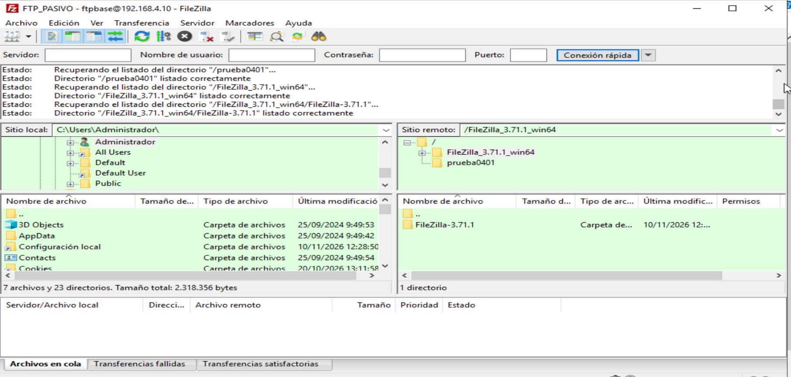
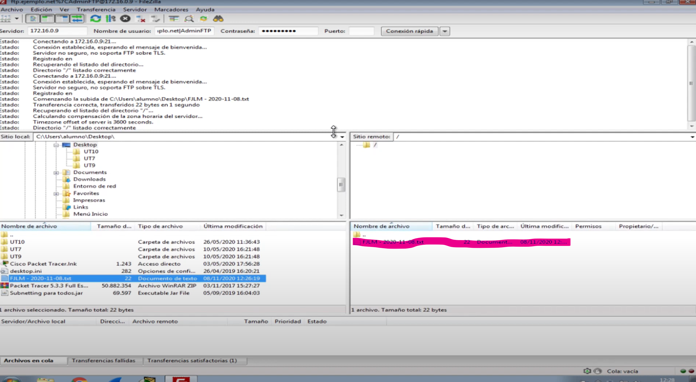
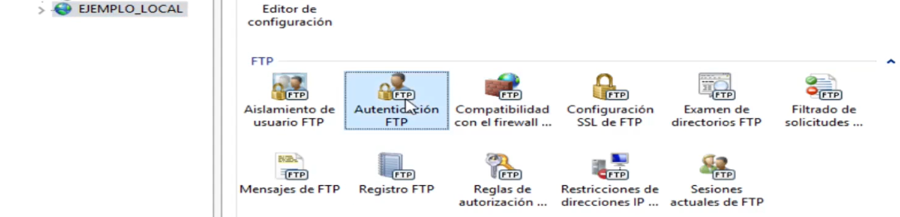

# 0402 · FTP Windows: activo y pasivo

El FTP de la empresa ya funciona en el servidor. Ahora lo utilizarás desde **otro equipo**: primero con FileZilla y después con la consola que conoces de 0401.

En ambas pruebas listarás, subirás y descargarás archivos con la misma cuenta. FileZilla trabajará en **pasivo** y el cliente de consola `ftp.exe` en **activo**.

[Preparar el cliente](#1-preparar-el-cliente) · [FileZilla en pasivo](#2-probar-con-filezilla-en-pasivo) · [Consola en activo](#3-probar-desde-consola-en-activo) · [Comparar](#4-comparar-los-resultados) · [Entrega](#qué-debes-entregar) · [Ayuda](#ayuda-opcional)

## 1. Preparar el cliente

Conserva el servidor y la cuenta de 0401. **No reinstales FTP ni crees otro sitio.**

| Elemento | Configuración |
|---|---|
| Servidor existente | `FTP-SRV` · `192.168.4.10/24` |
| Cliente | Otra VM Windows · `FTP-CLI` · `192.168.4.20/24` |
| Red de ambas VM | Red interna de VirtualBox `SR-FTP` |
| Puerta de enlace y DNS | En blanco durante las pruebas |
| Sitio y carpeta | `FTP_EMPRESA` · `C:\FTP\Empresa` |
| Cuenta | `ftpbase` y su contraseña de laboratorio |

1. Prepara un clon Windows para el cliente, con una MAC nueva; conserva las máquinas de DNS. Configura su red según la tabla y comprueba las IP con `ipconfig`.
2. Comprueba que el cliente tiene **FileZilla Client**. Si falta, utiliza el instalador que facilite el profesor; prepara la instalación antes de las pruebas en la red interna.
3. Desde **PowerShell del cliente**, ejecuta:

```powershell
Test-NetConnection 192.168.4.10 -Port 21
```

**Comprueba:** `TcpTestSucceeded : True`. Si funciona, continúa: no necesitas crear otra regla para el puerto 21. Si falla, revisa IP, red interna y sitio iniciado con el profesor.

Esta prueba comprueba el acceso al canal de control; las transferencias se comprobarán después. Mantén el cortafuegos activo y utiliza las reglas existentes cuando permitan el servicio.

## 2. Probar con FileZilla en pasivo

En **FTP-CLI**:

1. Abre **FileZilla → Archivo → Gestor de sitios → Nuevo sitio**. Llámalo `FTP_EMPRESA_PASIVO` y completa:

   | Campo | Valor |
   |---|---|
   | Protocolo | FTP |
   | Servidor y puerto | `192.168.4.10` · `21` |
   | Cifrado | Usar solamente FTP simple |
   | Modo de acceso | Preguntar la contraseña |
   | Usuario | `ftpbase` |

2. En **Configuración de transferencia**, selecciona **Pasivo** y conecta.
3. Crea en el cliente `C:\FTP_CLIENTE` y, dentro, `0402_pasivo.txt`, con una frase propia. Activa las extensiones de archivo para evitar nombres terminados en `.txt.txt`.
4. En FileZilla, el panel izquierdo es el cliente y el derecho, el servidor. Comprueba el listado remoto y sube tu archivo.
5. Crea la subcarpeta local `C:\FTP_CLIENTE\descargas`, entra en ella desde el panel izquierdo y descarga el archivo que acabas de subir. Ábrelo y comprueba su contenido.
6. En el registro superior, localiza `PASV` o `EPSV` y una transferencia terminada correctamente. Después, **desconecta FileZilla**.

📸 **Captura 1:** registro de FileZilla que identifica el modo pasivo y una transferencia correcta.

**Comprueba:** has listado, subido y descargado. En pasivo, **el cliente inicia también la conexión de datos**.

> Interfax de Filezilla
> 

## 3. Probar desde consola en activo

Utiliza **FTP-CLI** y la misma cuenta. El cliente `ftp.exe` de Windows trabaja en activo: no hay que configurar el modo activo de FileZilla.

1. En `C:\FTP_CLIENTE`, crea `0402_consola.txt` con una frase distinta.
2. Abre **CMD** y ejecuta:

```cmd
cd /d C:\FTP_CLIENTE
ftp 192.168.4.10
```

3. Introduce `FTP-SRV\ftpbase` y su contraseña, como en 0401.
4. Cuando aparezca `ftp>`, ejecuta una por una:

```text
debug
binary
dir
put 0402_consola.txt
get 0402_consola.txt 0402_consola_descarga.txt
quit
```

`debug` permite ver las órdenes que envía el cliente. Se activa **después de identificarte**. Busca `PORT` o `EPRT` al listar o transferir; las respuestas deben indicar que la operación ha terminado correctamente.

5. Abre `C:\FTP_CLIENTE\0402_consola_descarga.txt` y comprueba que contiene la frase del archivo original.

📸 **Captura 2:** consola con la orden que identifica el modo activo y una transferencia terminada correctamente.

**Comprueba:** también has listado, subido y descargado. En activo, **el servidor inicia la conexión de datos hacia el cliente**. Si una operación se queda esperando o devuelve un error, conserva el mensaje y consulta la ayuda; no cambies los permisos de `ftpbase`.

## 4. Comparar los resultados

Completa con tus pruebas:

| Cliente | Modo | ¿Quién inicia la conexión de datos? | ¿Han funcionado listado, subida y descarga? |
|---|---|---|---|
| FileZilla | Pasivo | | |
| `ftp.exe` | Activo | | |

Responde en dos o tres frases por cuestión:

1. ¿Por qué poder iniciar sesión no demuestra que la transferencia de archivos funcione?
2. ¿Por qué has podido subir y descargar en ambos modos? Explica qué diferencia hay realmente entre activo y pasivo.

## Qué debes entregar

Entrega **un único PDF**, llamado `0402_Apellidos_Nombre.pdf`, de **un máximo de 3 páginas en total**, incluidas portada, tablas y anexos. No necesitas portada independiente.

Incluye:

- Las **dos capturas** indicadas, legibles y con una explicación breve de lo que demuestran.
- La tabla comparativa y las dos respuestas.
- Una frase sobre una incidencia real y su solución, si se ha producido.

No incluyas contraseñas ni el guion copiado. Conserva el laboratorio para 0403.

## Cómo se valorará

| Calificación | Criterio |
|---|---|
| 0 | **No entregado.** |
| 3 | **La mayoría de las respuestas son incorrectas.** La tarea presenta errores importantes que muestran una comprensión insuficiente de los contenidos o dificultades para aplicar los procedimientos trabajados. |
| 6 | **La mayoría de las respuestas son correctas.** Se demuestra una comprensión general de los contenidos y una aplicación adecuada de los procedimientos, aunque quedan errores u omisiones por corregir. |
| 9 | **Todo correcto.** La tarea responde de forma completa y correcta a lo solicitado, con explicaciones claras y procedimientos bien aplicados. |
| 10 | **Todo correcto y con una aportación extra.** Además de resolver correctamente la tarea, el alumno incorpora una aportación propia y pertinente que enriquece el trabajo, como un ejemplo, una comprobación adicional o una reflexión razonada. |

## Ayuda opcional

La práctica se realiza con FTP simple en una red interna aislada y con credenciales de laboratorio. No requiere configurar rangos personalizados de puertos cuando las conexiones ya funcionan.

<details markdown="block">
<summary>Si alguna comprobación falla</summary>

| Síntoma | Primera comprobación |
|---|---|
| No se alcanza TCP 21 | IP, red interna, servicio y sitio iniciados. En el servidor, revisar que la regla **Servidor FTP (entrada de tráfico FTP)** esté habilitada. |
| Se rechaza la identificación | Cuenta de 0401, contraseña, autenticación básica y autorización de `ftpbase`. |
| FileZilla conecta, pero no lista en pasivo | Confirmar Pasivo, revisar con el profesor el servicio y la regla de FTP pasivo del servidor. |
| La consola identifica al usuario, pero no lista o transfiere | Revisar con el profesor la entrada de datos hacia `ftp.exe` en el cliente. |
| No se encuentra el archivo de `put` | Comprobar nombre y carpeta local `C:\FTP_CLIENTE`. |

Si el profesor confirma que el cortafuegos del **cliente** bloquea los datos activos y no hay una regla que los permita, puede autorizar este programa desde **PowerShell como administrador de FTP-CLI**:

```powershell
New-NetFirewallRule -DisplayName "SR FTP consola" -Direction Inbound -Action Allow -Protocol TCP -Program "$env:SystemRoot\System32\ftp.exe" -RemoteAddress 192.168.4.10
```

Este ajuste es solo para ese bloqueo: no lo ejecutes si las transferencias ya funcionan. Si existe esa regla, revisadla en lugar de duplicarla. El profesor comprobará cualquier ajuste necesario en el servidor; no es una tarea de diseño de cortafuegos.

</details>

<details markdown="block">
<summary>Imágenes para reconocer las herramientas</summary>



*El registro está arriba, el cliente a la izquierda y el servidor a la derecha. Es una imagen histórica: utiliza la IP, la cuenta y los archivos de este guion. La imagen no demuestra por sí sola el modo utilizado.*



*Referencia para localizar herramientas si el profesor necesita revisar el servicio. No copies los datos históricos de la imagen ni cambies el rango de puertos si las conexiones funcionan.*

</details>
