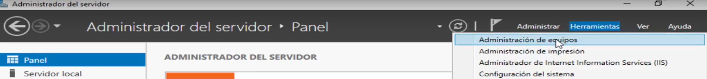
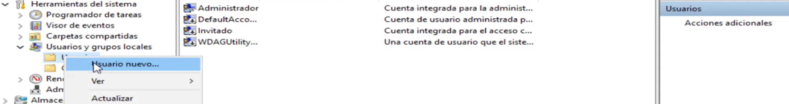
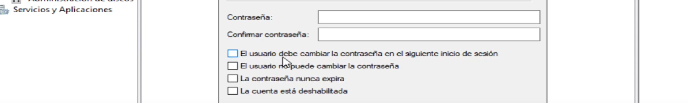
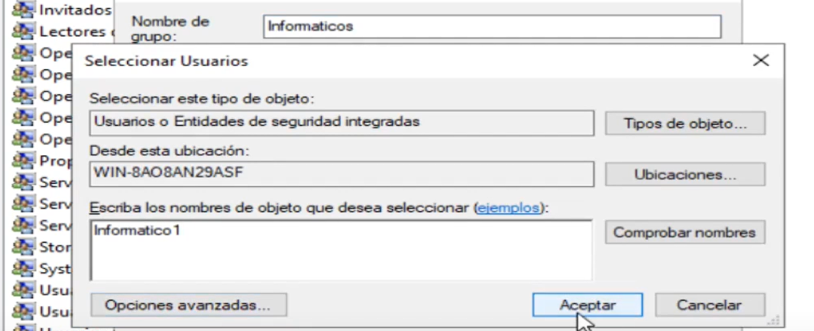
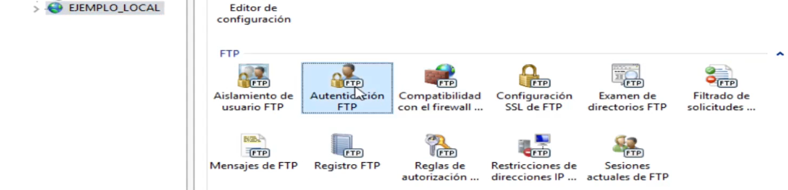
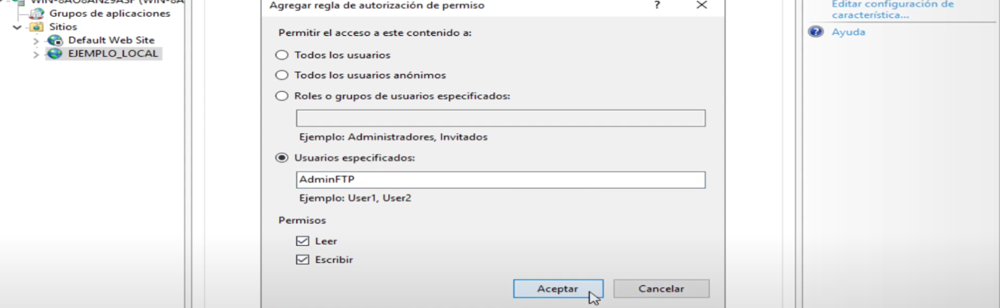
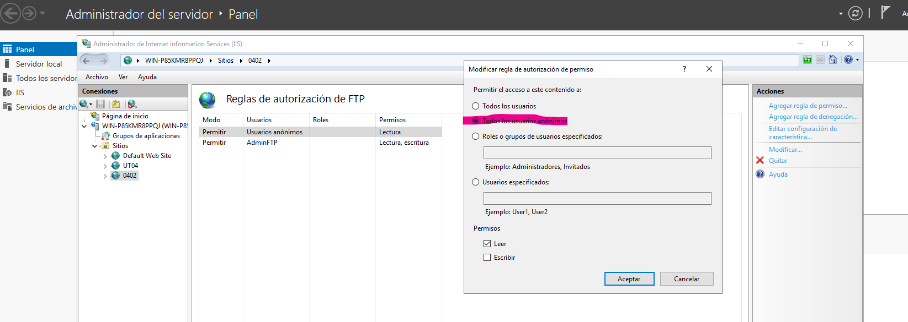
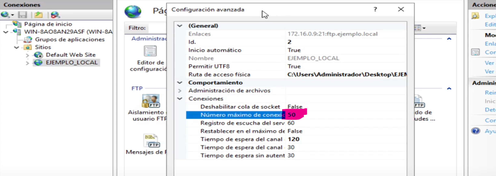

# 0403 · FTP Windows: usuarios y acceso anónimo

La empresa necesita distinguir responsabilidades: Informática puede modificar archivos, Contabilidad solo puede consultarlos y los visitantes pueden descargar información pública.

Continuarás con el mismo laboratorio. **No se cambian la red, los puertos ni los modos de conexión.** Esta vez cambiaremos quién accede y qué puede hacer.

[Punto de partida](#1-comprobar-el-punto-de-partida) · [Cuentas y grupos](#2-crear-tres-cuentas-y-dos-grupos) · [Permisos](#3-configurar-los-permisos) · [Probar usuarios](#4-comprobar-informática-y-contabilidad) · [Anónimo](#5-permitir-y-probar-el-acceso-anónimo) · [Límite](#6-comprobar-un-límite-de-conexiones) · [Entrega](#qué-debes-entregar) · [Ayuda](#ayuda-visual-opcional)

## 1. Comprobar el punto de partida

| Elemento | Configuración que se conserva |
|---|---|
| Servidor | `FTP-SRV` · `192.168.4.10/24` |
| Cliente | `FTP-CLI` · `192.168.4.20/24` · FileZilla y `ftp.exe` |
| Red | Interna `SR-FTP`, sin puerta de enlace ni DNS |
| Sitio y carpeta | `FTP_EMPRESA` · TCP 21 · `C:\FTP\Empresa` |

1. Desde el cliente, conecta con FileZilla en **pasivo** y `ftpbase`. Comprueba un listado y una descarga.
2. Desconecta la sesión. Conserva esa conexión como modelo para las pruebas siguientes.
3. En IIS, selecciona **FTP_EMPRESA**. En **Configuración básica**, conserva la ruta y **Conectar como → Usuario de aplicación / autenticación de paso**.
4. En **Aislamiento de usuario FTP**, selecciona **No aislar usuarios → Directorio raíz FTP**. Todos utilizarán la misma carpeta.

Utiliza las contraseñas de laboratorio y mantén el cortafuegos activo. Guarda una instantánea del servidor antes de cambiar los permisos.

## 2. Crear tres cuentas y dos grupos

En **FTP-SRV → Administrador del servidor → Herramientas → Administración de equipos → Usuarios y grupos locales**, crea:

| Cuenta | Grupo de esta práctica | Función |
|---|---|---|
| `adminftp` | Ninguno de los dos grupos siguientes | Gestionar el contenido y probar el límite |
| `informatico1` | `informaticos` | Leer y modificar |
| `contable1` | `contables` | Leer y descargar |

1. En **Usuarios → Usuario nuevo**, crea las tres cuentas, con contraseñas de laboratorio. Desmarca **El usuario debe cambiar la contraseña en el siguiente inicio de sesión**.
2. En **Grupos → Grupo nuevo**, crea `informaticos` y `contables`.
3. Abre cada grupo y agrega el usuario indicado en la tabla. En el selector, usa **Ubicaciones → FTP-SRV → Comprobar nombres**.
4. Comprueba que las cuentas estén habilitadas y no pertenezcan a **Administradores**. `adminftp` es un usuario ordinario de Windows.

Solo necesitas **un usuario por grupo**; no crees cuentas adicionales. Si alguno ya existe, comprueba su configuración y conserva su contraseña.

## 3. Configurar los permisos

La operación debe estar permitida en **IIS y en Windows**. Utiliza esta misma tabla para ambas configuraciones:

| Destinatario | Autorización FTP en IIS | Permiso NTFS sobre `C:\FTP\Empresa` |
|---|---|---|
| Usuario `adminftp` | Lectura y escritura | Modificar |
| Grupo `informaticos` | Lectura y escritura | Modificar |
| Grupo `contables` | Lectura | Lectura y ejecución |

### 3.1. Autorizar en IIS

1. En **FTP_EMPRESA → Autenticación FTP**, conserva **Básica** habilitada y **Anónima** deshabilitada por ahora.
2. En **Reglas de autorización FTP**, retira la regla de `ftpbase`. Conserva su cuenta de Windows; simplemente dejará de tener acceso a este sitio.
3. Agrega las tres reglas de la tabla: **Usuarios especificados** para `adminftp` y **Roles o grupos de usuarios especificados** para los dos grupos.
4. Si hay reglas generales de permiso para **Todos los usuarios**, retíralas del sitio de laboratorio. Consulta al profesor antes de modificar una regla heredada que afecte a otros sitios.

### 3.2. Dar acceso a la carpeta en Windows

1. En el Explorador, abre **C:\FTP\Empresa → Propiedades → Seguridad → Opciones avanzadas**.
2. Si necesitas editar permisos heredados, utiliza **Deshabilitar herencia → Convertir los permisos heredados en permisos explícitos**.
3. Conserva **Control total** para `SYSTEM` y **Administradores**. Retira la entrada específica de `ftpbase` y las entradas amplias de **Usuarios**, **Usuarios autenticados** o **Todos**, si existen en esta carpeta.
4. Añade los permisos de la tabla, aplicados a **Esta carpeta, subcarpetas y archivos**. No añadas reglas **Denegar**: las cuentas de lectura deben quedar sin permisos de escritura.
5. Comprueba que los archivos utilizados hereden esos permisos. Si tienen entradas particulares que contradigan la tabla, revísalas con el profesor.
6. Desde el servidor, crea `C:\FTP\Empresa\normas_empresa.txt`, con dos líneas de información ficticia.

📸 **Captura 1:** configuración final de autorización FTP y permisos NTFS. Puedes reunir ambas vistas en una figura; la completarás con el acceso anónimo.

## 4. Comprobar Informática y Contabilidad

En el cliente, crea `it_prueba.txt` y `contable_prueba.txt`. Utiliza FileZilla en **pasivo**, con la IP del servidor y FTP simple.

1. Conecta como **`informatico1`**: lista, descarga `normas_empresa.txt` y sube `it_prueba.txt`.
2. Desconecta. Cambia el usuario a **`contable1`** y vuelve a conectar: lista y descarga `normas_empresa.txt`; intenta subir `contable_prueba.txt`.
3. Comprueba en el servidor que `it_prueba.txt` existe y que `contable_prueba.txt` no se ha creado.

**Resultado esperado:** Informática puede leer y escribir; Contabilidad puede leer y su subida se rechaza. Un rechazo previsto es una comprobación correcta.

📸 **Captura 2:** descarga correcta y subida rechazada de Contabilidad, con el usuario y el mensaje del servidor visibles. Anota también el resultado de Informática en la tabla de entrega.

## 5. Permitir y probar el acceso anónimo

El visitante tendrá acceso de lectura a todo el contenido de esta carpeta de laboratorio. Utiliza solo información ficticia.

En **FTP-SRV**:

1. En **FTP_EMPRESA → Autenticación FTP**, habilita **Anónima** y conserva **Básica**.
2. En **Anónima → Editar**, comprueba que el usuario específico sea **`IUSR`**. No crees una cuenta Windows llamada `anonymous`.
3. En **Reglas de autorización FTP**, agrega **Todos los usuarios anónimos**, con **Lectura**, sin Escritura.
4. En la seguridad de `C:\FTP\Empresa`, añade **IUSR → Lectura y ejecución**, para carpeta, subcarpetas y archivos. Comprueba que no reciba escritura por otra entrada.

Completa la **captura 1** con esta configuración final.

En **FTP-CLI**:

5. Desconecta FileZilla. En el Gestor de sitios copia la conexión pasiva y selecciona **Modo de acceso → Anónimo**. Conserva IP, puerto y FTP simple.
6. Lista y descarga `normas_empresa.txt`. Después, intenta subir un archivo `anon_prueba.txt` que hayas creado en el cliente y borrar **solo** `it_prueba.txt`, el archivo de prueba de Informática.
7. Comprueba que descarga correctamente, que se rechazan subida y borrado y que `it_prueba.txt` sigue existiendo. Si se solicita una contraseña anónima, utiliza un texto ficticio.

📸 **Captura 3:** acceso anónimo, descarga correcta y rechazo de escritura. Anota el intento de borrado en la tabla.

## 6. Comprobar un límite de conexiones

Ahora se limita el número de sesiones, sin cambiar los permisos.

1. Desconecta FileZilla y cierra las sesiones FTP abiertas.
2. En **FTP_EMPRESA → Configuración avanzada → Conexiones**, anota el máximo previo y cambia **Máximo de conexiones** a **2**. Conserva **Restablecer al alcanzar el máximo de conexiones = False**.
3. En el cliente, abre **dos ventanas de CMD**. En cada una ejecuta:

```cmd
ftp 192.168.4.10
```

Identifícate como `adminftp` y deja ambas sesiones abiertas en `ftp>`. **No ejecutes listados ni transferencias** durante esta prueba.

4. Abre una tercera ventana y ejecuta también `ftp 192.168.4.10`: debe rechazarse la conexión adicional.
5. En la primera ventana ejecuta `quit`. En la tercera, si permanece `ftp>`, ejecuta `open 192.168.4.10`; si estás en CMD, repite `ftp 192.168.4.10`. Ahora debe permitir la identificación.
6. Cierra las sesiones con `quit` y restaura el valor de trabajo **50**, salvo que el profesor haya indicado otro. Haz la prueba seguida, antes de que las sesiones caduquen por inactividad.

📸 **Captura 4:** rechazo de la conexión adicional. Explica que, al liberar una plaza, has podido entrar, y confirma que has restaurado el máximo.

## Qué debes entregar

Entrega **un único PDF**, llamado `0403_tunombre.pdf`, de **un máximo de 4 páginas en total**, incluidas portada, tablas y anexos. No necesitas portada independiente.

Incluye:

- Identificación breve del servidor, del cliente y de las tres cuentas y sus grupos.
- Las **cuatro capturas** indicadas, legibles y con una explicación breve. Puedes combinar vistas en una misma figura.
- Esta tabla completada con tus resultados:

| Acceso | Descargar | Subir | Borrar `it_prueba.txt` |
|---|---|---|---|
| Informática | | | No solicitado |
| Contabilidad | | | No solicitado |
| Anónimo | | | |

Responde brevemente:

1. ¿Por qué dar escritura en IIS puede no ser suficiente para subir un archivo?
2. ¿Qué diferencia hay entre rechazar una operación por permisos y rechazar una conexión por el límite?

Añade el resultado del límite, su restauración y una incidencia real si la hubo. No entregues contraseñas ni el guion copiado. Conserva el laboratorio.

## Cómo se valorará

| Calificación | Criterio |
|---|---|
| 0 | **No entregado.** |
| 3 | **La mayoría de las respuestas son incorrectas.** La tarea presenta errores importantes que muestran una comprensión insuficiente de los contenidos o dificultades para aplicar los procedimientos trabajados. |
| 6 | **La mayoría de las respuestas son correctas.** Se demuestra una comprensión general de los contenidos y una aplicación adecuada de los procedimientos, aunque quedan errores u omisiones por corregir. |
| 9 | **Todo correcto.** La tarea responde de forma completa y correcta a lo solicitado, con explicaciones claras y procedimientos bien aplicados. |
| 10 | **Todo correcto y con una aportación extra.** Además de resolver correctamente la tarea, el alumno incorpora una aportación propia y pertinente que enriquece el trabajo, como un ejemplo, una comprobación adicional o una reflexión razonada. |

## Ayuda visual opcional

<details markdown="block">
<summary>Abrir las imágenes de ayuda</summary>

Las imágenes proceden del laboratorio anterior. Utilízalas para localizar opciones, con los nombres, IP y permisos de este guion. No forman parte de las capturas de entrega.

### Usuarios y grupos










*Crea solo las tres cuentas y los dos grupos de esta práctica.*

### Autorización y acceso anónimo






*La cuenta AdminFTP y el sitio del ejemplo son históricos. Utiliza `adminftp` en `FTP_EMPRESA` y las reglas de grupos de la tabla.*



*Selecciona Todos los usuarios anónimos y Lectura, sin Escritura. La identidad `IUSR` y sus permisos NTFS se comprueban por separado.*

### Pruebas y límite de conexiones


*Panel izquierdo: cliente. Panel derecho: servidor. El registro muestra las respuestas de cada operación.*




*La imagen histórica muestra 50. En la prueba se usa temporalmente 2 y después se restaura el valor de trabajo. No copies los demás datos históricos.*

</details>
