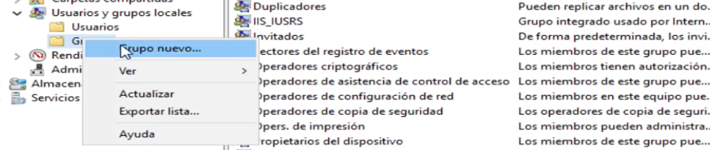
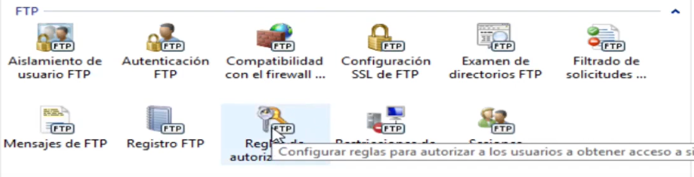
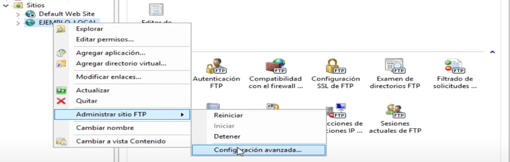
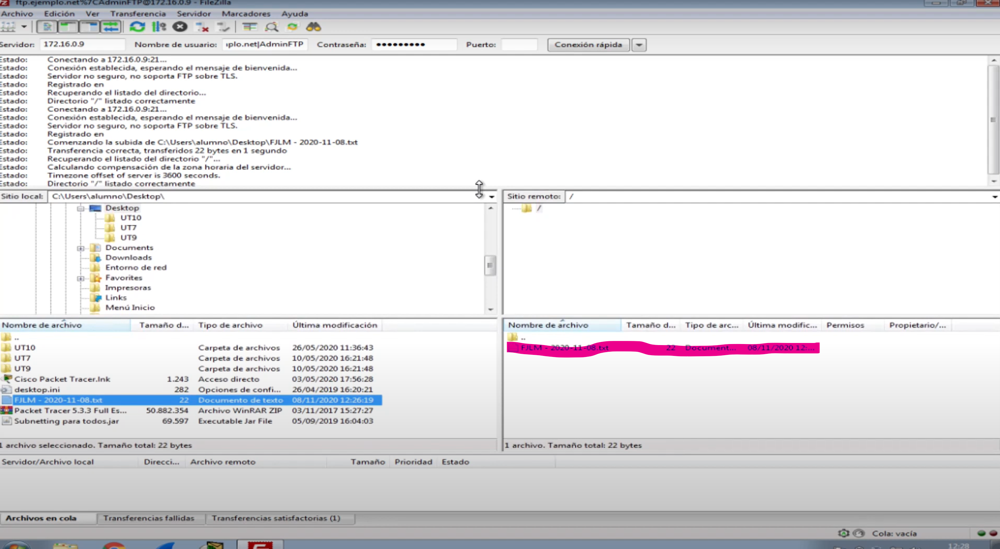

# 0403 · FTP Windows: usuarios y acceso anónimo

Las imágenes de ayuda proceden de los guiones anteriores. Utiliza los datos del escenario y de cada paso. Las capturas de tu entrega corresponderán a tus propios equipos. [Consultar la ayuda visual](#ayuda-visual).

[Escenario](#escenario-de-trabajo) · [Punto de partida](#1-comprobar-el-punto-de-partida) · [Usuarios y grupos](#2-crear-los-usuarios-y-grupos-locales) · [Autorización FTP](#3-configurar-la-autorización-en-iis) · [Permisos Windows](#4-ajustar-los-permisos-de-la-carpeta-en-windows) · [Accesos identificados](#5-comprobar-los-accesos-identificados) · [Acceso anónimo](#6-habilitar-el-acceso-anónimo-de-solo-lectura) · [Prueba anónima](#7-probar-al-visitante-anónimo) · [Límite de conexiones](#8-establecer-y-comprobar-un-límite-de-conexiones) · [Resultados](#9-explicar-los-resultados) · [Entrega](#qué-debes-entregar) · [Valoración](#cómo-se-valorará)

## Objetivo de la práctica

Configurar un mismo servidor FTP para personas con distintas responsabilidades. El personal de Informática podrá leer y modificar archivos; el de Contabilidad podrá consultarlos; cualquier visitante podrá descargar la información pública mediante acceso anónimo.

Comprobarás los permisos con operaciones reales y aplicarás un límite de conexiones. Una operación denegada será un resultado correcto cuando así lo establezca la política de acceso.

## Escenario de trabajo

Continúa con el servidor y el cliente de las prácticas anteriores. Conserva la configuración de red y de los modos activo y pasivo.

| Elemento | Configuración |
|---|---|
| Servidor | Windows Server 2019 · `FTP-SRV` · `192.168.4.10/24` |
| Cliente | Windows · `FTP-CLI` · `192.168.4.20/24` · FileZilla y `ftp.exe` |
| Red de VirtualBox | Red interna `SR-FTP`, sin puerta de enlace ni DNS |
| Sitio FTP | `FTP_EMPRESA` · puerto `21` · sin nombre de host virtual |
| Carpeta publicada por FTP | `C:\FTP\Empresa` |

Trabaja en estas máquinas de laboratorio. Mantén el cortafuegos y utiliza contraseñas exclusivas de la práctica. Las pruebas se realizan con FTP sin cifrado en la red interna; no emplees credenciales personales.

## 1. Comprobar el punto de partida

**Ayuda:** [herramientas de IIS](#v6-autenticación-y-reglas-de-autorización) y [ayuda de la identidad de acceso](#v11-identidad-de-acceso-y-aislamiento).

1. Accede desde el cliente con `ftpbase` y comprueba que puedes listar y transferir un archivo, como en la práctica anterior.
2. Desconecta FileZilla y cierra las sesiones FTP abiertas.
3. En el servidor, abre **Administrador de IIS → Sitios → FTP_EMPRESA**.
4. En **Configuración básica**, comprueba la ruta `C:\FTP\Empresa`. En **Conectar como…**, conserva **Usuario de aplicación / autenticación de paso**. No introduzcas una cuenta fija para acceder a la carpeta.
5. En **Aislamiento de usuario FTP**, selecciona **No aislar usuarios → Directorio raíz FTP**. Todos trabajarán sobre la misma carpeta compartida.

La identidad utilizada para acceder al contenido debe corresponder al usuario autenticado o, para el acceso anónimo, a la identidad configurada para ese acceso.

## 2. Crear los usuarios y grupos locales

**Ayuda:** [Administración de equipos](#v1-abrir-administración-de-equipos), [crear usuarios](#v2-crear-un-usuario-local), [opción de contraseña](#v3-cambio-de-contraseña-en-el-siguiente-inicio), [crear grupos](#v4-crear-un-grupo-local) y [agregar miembros](#v5-agregar-miembros-a-un-grupo).

En `FTP-SRV`, abre **Administrador del servidor → Herramientas → Administración de equipos → Usuarios y grupos locales**.

1. En **Usuarios**, crea las siguientes cuentas locales si todavía no existen:

   - `adminftp`
   - `informatico1` y `informatico2`
   - `contable1` y `contable2`

2. Asigna las contraseñas de laboratorio. Desmarca **El usuario debe cambiar la contraseña en el siguiente inicio de sesión**: el cliente FTP no realiza ese cambio interactivo.
3. En **Grupos**, crea `informaticos` y `contables`.
4. Abre cada grupo y agrega sus dos usuarios mediante **Agregar → Opciones avanzadas / Comprobar nombres**. Selecciona el equipo `FTP-SRV` como ubicación cuando sea necesario.
5. Comprueba la pertenencia a los grupos:

| Usuario | Grupo de trabajo | Función en el FTP |
|---|---|---|
| `adminftp` | No necesita pertenecer a los grupos anteriores | Gestionar el contenido compartido |
| `informatico1`, `informatico2` | `informaticos` | Leer y modificar el contenido |
| `contable1`, `contable2` | `contables` | Consultar y descargar el contenido |

`adminftp` es un usuario ordinario para gestionar este FTP. **No lo agregues al grupo Administradores de Windows.**

## 3. Configurar la autorización en IIS

**Ayuda:** [localizar Reglas de autorización FTP](#v7-abrir-reglas-de-autorización-ftp).

En **FTP_EMPRESA → Autenticación FTP**, mantén **Autenticación básica** habilitada y, de momento, **Autenticación anónima** deshabilitada.

Abre **Reglas de autorización FTP**:

1. Retira la regla de `ftpbase`: a partir de ahora utilizarás las nuevas cuentas.
2. Si aparecen reglas generales que concedan acceso a **Todos los usuarios**, retíralas del sitio de laboratorio. Comprueba también si existe alguna regla heredada que impida obtener la política indicada; consúltala con el profesor antes de cambiar la configuración de otros sitios.
3. Mediante **Agregar regla de permiso**, establece:

| Destinatario de la regla | Selección en el diálogo | Permisos FTP |
|---|---|---|
| `adminftp` | Usuarios especificados | Lectura y escritura |
| `informaticos` | Roles o grupos de usuarios especificados | Lectura y escritura |
| `contables` | Roles o grupos de usuarios especificados | Lectura |

Escribe los grupos como se han creado. No agregues una denegación general para conseguir la política: las cuentas sin una autorización aplicable no deben tener acceso.

**Ayuda visual: regla para un usuario identificado.**


*Fíjate en **Usuarios especificados** y en las casillas **Leer** y **Escribir**. La cuenta `AdminFTP` y el sitio `EJEMPLO_LOCAL` son los del ejemplo histórico: utiliza `adminftp` en `FTP_EMPRESA`. Para los dos grupos, selecciona **Roles o grupos de usuarios especificados** y aplica los permisos de la tabla.*

📸 **Captura 1: reglas de autorización FTP.** Deben verse los destinatarios y sus permisos. La completarás después con la regla anónima.

## 4. Ajustar los permisos de la carpeta en Windows

**Ayuda:** [ayuda de los permisos NTFS finales](#v12-permisos-ntfs-finales).

La autorización FTP y los permisos NTFS de la carpeta deben permitir la operación. Conceder escritura en IIS no permite escribir en una carpeta que Windows mantiene como solo lectura para esa cuenta.

1. En el Explorador del servidor, abre **C:\FTP\Empresa → Propiedades → Seguridad → Opciones avanzadas**.
2. Revisa a qué identidades se permite acceder y qué permisos se heredan. Si necesitas ajustar la herencia, pulsa **Deshabilitar herencia → Convertir los permisos heredados en permisos explícitos**.
3. Conserva **Control total** para `SYSTEM` y para **Administradores**.
4. Retira el permiso específico de `ftpbase`. Revisa las entradas amplias, como **Usuarios**, **Usuarios autenticados** o **Todos**: en esta carpeta de laboratorio no deben conceder permisos adicionales a las cuentas de la práctica. Retira esas entradas de esta carpeta si existen.
5. Agrega las siguientes entradas de **Permitir**, aplicadas a **Esta carpeta, subcarpetas y archivos**:

| Identidad | Permiso NTFS |
|---|---|
| `FTP-SRV\adminftp` | Modificar |
| `FTP-SRV\informaticos` | Modificar |
| `FTP-SRV\contables` | Lectura y ejecución; mostrar el contenido de la carpeta; lectura |

No marques **Denegar** para los grupos de lectura: una cuenta puede pertenecer a más de un grupo y una denegación podría anular otro permiso necesario.

6. Comprueba que los archivos y subcarpetas utilizados heredan esos permisos y que no conservan entradas particulares que contradigan la política. Si las hay, revísalas con el profesor antes de continuar.
7. Desde el propio servidor, crea con el Bloc de notas `C:\FTP\Empresa\normas_empresa.txt`, con dos líneas de información de la empresa ficticia.

📸 **Captura 2: permisos de la carpeta.** Conserva la vista de seguridad avanzada con las identidades y permisos. La completarás con `IUSR` en el apartado 6.

## 5. Comprobar los accesos identificados

**Ayuda:** [paneles y registro de FileZilla](#v10-reconocer-los-resultados-en-filezilla) y [comprobaciones de permisos](#v14-operaciones-permitidas-y-denegadas).

En el cliente, prepara dos archivos de texto pequeños: `it_prueba.txt` y `contable_prueba.txt`. Utiliza FileZilla en el modo pasivo que ya has comprobado. El modo de conexión se mantiene igual al comparar usuarios.

Para cada cuenta, desconecta la sesión anterior y vuelve a conectar a `192.168.4.10`, puerto `21`, con **FTP simple**. En las cuentas locales utiliza el nombre del usuario, sin añadir un nombre de host virtual.

1. **`adminftp`:** lista la carpeta, descarga `normas_empresa.txt`, sube un archivo de prueba y elimina ese mismo archivo de prueba.
2. **`informatico1`:** descarga `normas_empresa.txt`, sube `it_prueba.txt` y crea la carpeta `trabajo_it`.
3. **`contable1`:** descarga `normas_empresa.txt` e intenta subir `contable_prueba.txt` y crear `trabajo_contabilidad`.

Resultados que debes comprobar:

| Cuenta | Listar y descargar | Subir y crear carpeta |
|---|---|---|
| `adminftp` | Permitido | Permitido |
| `informatico1` | Permitido | Permitido |
| `contable1` | Permitido | Denegado |

Tras las pruebas, abre `C:\FTP\Empresa` en el servidor: `it_prueba.txt` y `trabajo_it` deben existir; `contable_prueba.txt` y `trabajo_contabilidad` no deben haberse creado.

📸 **Captura 3: acceso de Informática.** Muestra el usuario conectado y una operación de escritura correcta.

📸 **Captura 4: acceso de Contabilidad.** Muestra el usuario conectado, la descarga correcta y el rechazo de una operación de escritura. Conserva el mensaje del servidor y explica su significado.

Si recibes un error antes de ver el contenido, revisa primero usuario, contraseña y autorización. Si puedes entrar pero falla el listado, recupera las comprobaciones de activo/pasivo de 0402. Si la transferencia se rechaza por permisos, revisa tanto IIS como NTFS.

## 6. Habilitar el acceso anónimo de solo lectura

Se desea publicar el contenido de esta carpeta de laboratorio para que un visitante pueda descargarlo sin disponer de una cuenta personal. Por ello, todos los archivos de esta carpeta serán públicos para ese visitante; no coloques información privada.

En el servidor:

1. Abre **FTP_EMPRESA → Autenticación FTP**. Mantén habilitada **Autenticación básica** y habilita también **Autenticación anónima**.
2. Selecciona **Autenticación anónima → Editar…**. Comprueba que utiliza el usuario específico **IUSR**. Conserva esa identidad y no crees una cuenta local llamada `anonymous` o `anonimo`.
3. En **Reglas de autorización FTP**, agrega una regla para **Todos los usuarios anónimos**, con **Lectura** y sin **Escritura**. Conserva las reglas de los usuarios y grupos anteriores.
4. En **C:\FTP\Empresa → Propiedades → Seguridad**, agrega **IUSR** con **Lectura y ejecución**, **Mostrar el contenido de la carpeta** y **Lectura**, aplicadas a la carpeta, subcarpetas y archivos. En el selector de usuarios puedes usar **Ubicaciones → FTP-SRV → IUSR → Comprobar nombres**.
5. Revisa que `IUSR` no recibe escritura ni modificación por otra entrada de la carpeta.

Actualiza las capturas 1 y 2: deben mostrar la configuración final, incluido el acceso anónimo.

**Ayuda visual: permiso de lectura para visitantes.**


*Esta imagen sí muestra la selección que necesitas: **Todos los usuarios anónimos**, **Leer** marcado y **Escribir** sin marcar. El sitio `0402` es el del ejemplo anterior; añade la regla a `FTP_EMPRESA`, conservando las reglas de los usuarios y grupos de esta práctica. La identidad de Windows se comprueba por separado y debe ser `IUSR`.*

**Ayuda:** [ayuda de la identidad IUSR](#v13-identidad-anónima-iusr).

## 7. Probar al visitante anónimo

1. En el cliente crea `anon_prueba.txt`.
2. Desconecta la sesión de FileZilla. En **Archivo → Gestor de sitios**, copia la conexión pasiva y llámala `FTP_EMPRESA_ANONIMO`. Conserva IP, puerto, FTP simple y modo pasivo; cambia **Modo de acceso** a **Anónimo** y conecta. El cliente utiliza el nombre `anonymous`. Usa un texto ficticio si se solicita una contraseña; no introduzcas una dirección de correo personal.
3. Lista y descarga `normas_empresa.txt`.
4. Intenta subir `anon_prueba.txt` y crear `carpeta_anonima`.
5. Intenta eliminar **solo** el archivo de prueba `it_prueba.txt`, que creó Informática. Debe denegarse; no utilices archivos personales ni ajenos a esta práctica.
6. Comprueba en el servidor que el archivo de Informática sigue existiendo y que el visitante no ha creado su archivo ni su carpeta.

📸 **Captura 5: acceso anónimo.** Deben poder identificarse el visitante, una descarga correcta y una operación de escritura denegada. Anota también el resultado del intento de borrado.

Responde brevemente: ¿qué diferencia hay entre el nombre `anonymous` que utiliza el cliente y la identidad `IUSR` que utiliza Windows para acceder a la carpeta?

## 8. Establecer y comprobar un límite de conexiones

**Ayuda:** [abrir Configuración avanzada](#v8-abrir-la-configuración-avanzada-del-sitio) y [localizar Máximo de conexiones](#v9-localizar-el-número-máximo-de-conexiones).

La empresa permite acceder al contenido, pero también necesita limitar cuántas sesiones se mantienen abiertas. La prueba se hará con ventanas de consola para controlar exactamente las conexiones.

1. Desconecta FileZilla y cierra todas las sesiones FTP de los dos equipos.
2. En IIS, selecciona **FTP_EMPRESA → Configuración avanzada → Conexiones**. Anota el valor previo de **Máximo de conexiones** y cámbialo temporalmente a **2**. Para esta prueba conserva **Restablecer al alcanzar el máximo de conexiones = False**.
3. Desde el cliente, abre una primera ventana de CMD y ejecuta:

   ```cmd
   ftp 192.168.4.10
   ```

   Identifícate como `adminftp` y deja abierta la sesión en el indicador `ftp>`.

4. Abre una segunda ventana de CMD, repite la conexión y deja también autenticada la sesión. **No ejecutes listados ni transferencias durante esta prueba**: solo estamos contando sesiones de control.
5. Abre una tercera ventana y vuelve a ejecutar `ftp 192.168.4.10`. El servidor debe rechazar la conexión adicional por haber alcanzado el límite.
6. En la primera ventana ejecuta `quit`. En la tercera, si permanece el indicador `ftp>`, escribe `open 192.168.4.10`; si estás en CMD, ejecuta `ftp 192.168.4.10`. Ahora debe aceptarse la conexión y permitir la identificación.

Realiza la comprobación seguida, antes de que las primeras sesiones caduquen por inactividad. Si el resultado no coincide, revisa que no haya otras sesiones abiertas y consulta **Sesiones actuales FTP** en IIS. No modifiques permisos ni desactives el cortafuegos para resolver un límite de conexiones.

📸 **Captura 6: límite comprobado.** Conserva el rechazo de la conexión adicional y anota que, después de liberar una plaza, el nuevo acceso ha funcionado.

7. Cierra las ventanas con `quit` y restaura **Máximo de conexiones = 50**, el valor de trabajo del laboratorio. Si antes de la prueba había un valor diferente por indicación del profesor, restaura ese valor e indícalo en la memoria. Conserva las cuentas, los grupos y los permisos configurados.

## 9. Explicar los resultados

Completa una tabla con lo que ha ocurrido realmente para `adminftp`, `informatico1`, `contable1` y `anonymous`: listado, descarga, subida, creación de carpeta y, cuando se haya probado, borrado. Distingue **permitido**, **denegado** y **no probado**.

Responde también, en dos o tres frases por cuestión:

1. ¿Por qué una cuenta con escritura autorizada en IIS podría seguir sin poder subir un archivo?
2. ¿Cambiar de pasivo a activo debería conceder escritura al usuario anónimo? Justifica tu respuesta a partir de las dos dimensiones trabajadas.
3. ¿Qué cambia entre rechazar una subida por permisos y rechazar una conexión por haber alcanzado el máximo?

## Qué debes entregar

Entrega **un único PDF**, llamado `0403_tunombre.pdf`, de **6 páginas como máximo en total**, incluidas portada, tablas, capturas y cualquier anexo. No adjuntes otros archivos ni contraseñas.

Incluye:

- Una identificación breve del servidor y del cliente, las cuentas y su pertenencia a grupos.
- Las **seis capturas indicadas**, seleccionadas para que se lean los resultados. Puedes reunir varias vistas en una misma figura cuando sea necesario; cada figura debe seguir siendo legible.
- La tabla de resultados y las respuestas del apartado 9.
- Una frase sobre una incidencia real y su solución, si se ha producido, y la confirmación de que has restaurado el límite de conexiones.

Cada captura debe llevar una explicación breve de **qué has probado, qué resultado has obtenido y por qué es coherente con los permisos o el límite configurado**. No hace falta documentar cada clic del asistente.

## Cómo se valorará

| Calificación | Criterio |
|---|---|
| 0 | **No entregado.** |
| 3 | **La mayoría de las respuestas son incorrectas.** La tarea presenta errores importantes que muestran una comprensión insuficiente de los contenidos o dificultades para aplicar los procedimientos trabajados. |
| 6 | **La mayoría de las respuestas son correctas.** Se demuestra una comprensión general de los contenidos y una aplicación adecuada de los procedimientos, aunque quedan errores u omisiones por corregir. |
| 9 | **Todo correcto.** La tarea responde de forma completa y correcta a lo solicitado, con explicaciones claras y procedimientos bien aplicados. |
| 10 | **Todo correcto y con una aportación extra.** Además de resolver correctamente la tarea, el alumno incorpora una aportación propia y pertinente que enriquece el trabajo, como un ejemplo, una comprobación adicional o una reflexión razonada. |


---

## Ayuda visual

Estas imágenes proceden de los guiones anteriores y permiten reconocer los controles que utilizarás. El escenario de esta práctica es el de `FTP-SRV`, `FTP_EMPRESA` y `C:\FTP\Empresa`; los nombres antiguos que aparezcan en las imágenes no sustituyen a esos datos. Las imágenes de ayuda no forman parte de las seis capturas que debes obtener en tus equipos para la entrega.

### V1. Abrir Administración de equipos


*En el menú **Herramientas**, selecciona **Administración de equipos**.*

[Volver a usuarios y grupos](#2-crear-los-usuarios-y-grupos-locales).

### V2. Crear un usuario local


*Dentro de **Usuarios y grupos locales → Usuarios**, abre **Usuario nuevo…** para las cinco cuentas indicadas en el guion.*

[Volver a crear las cuentas](#2-crear-los-usuarios-y-grupos-locales).

### V3. Cambio de contraseña en el siguiente inicio


*La opción **El usuario debe cambiar la contraseña en el siguiente inicio de sesión** queda desmarcada para las cuentas FTP del laboratorio. Las contraseñas se introducen en tus máquinas; no se muestran en las capturas de entrega.*

[Volver a crear las cuentas](#2-crear-los-usuarios-y-grupos-locales).

### V4. Crear un grupo local



*En **Grupos → Grupo nuevo…**, crea `informaticos` y `contables`.*

[Volver a los grupos](#2-crear-los-usuarios-y-grupos-locales).

### V5. Agregar miembros a un grupo


*El selector permite escribir un usuario y pulsar **Comprobar nombres**. El nombre de equipo de la captura es antiguo: en **Ubicaciones** selecciona `FTP-SRV` y agrega los miembros definidos en la tabla del apartado 2.*

[Volver a la pertenencia a grupos](#2-crear-los-usuarios-y-grupos-locales).

### V6. Autenticación y reglas de autorización


*En **Autenticación FTP** se habilitan los métodos de acceso. El icono permite localizar la herramienta; realiza la configuración en `FTP_EMPRESA`.*

[Volver a la autenticación](#3-configurar-la-autorización-en-iis).

### V7. Abrir Reglas de autorización FTP



*Las **Reglas de autorización FTP** establecen quién puede leer o escribir. Utiliza las tres reglas de usuarios y grupos del guion y, después, la de los visitantes anónimos.*

[Volver a las reglas de autorización](#3-configurar-la-autorización-en-iis).

### V8. Abrir la configuración avanzada del sitio



*El menú muestra cómo llegar a **Administrar sitio FTP → Configuración avanzada…**. En el árbol selecciona tu sitio `FTP_EMPRESA`; el nombre `EJEMPLO_LOCAL` corresponde al ejemplo antiguo.*

[Volver al límite de conexiones](#8-establecer-y-comprobar-un-límite-de-conexiones).

### V9. Localizar el número máximo de conexiones


*Fíjate en **Conexiones → Número máximo de conexiones**. La imagen muestra el valor histórico **50**, que se utiliza como valor de trabajo al terminar. Para la prueba del apartado 8 introduce temporalmente **2**. Los enlaces, la IP, el nombre del sitio y la ruta visibles son los del laboratorio antiguo: no los copies.*

[Volver al límite de conexiones](#8-establecer-y-comprobar-un-límite-de-conexiones).

### V10. Reconocer los resultados en FileZilla



*El registro superior permite leer el resultado de cada operación. El panel izquierdo corresponde al cliente y el derecho al servidor. La imagen es un ejemplo antiguo de subida; utiliza tus IP, tus cuentas sin prefijo de host virtual y los archivos de prueba indicados en esta práctica.*

[Volver a los accesos identificados](#5-comprobar-los-accesos-identificados).

### V11. Identidad de acceso y aislamiento

En **FTP_EMPRESA → Configuración básica → Conectar como**, conserva **Usuario de aplicación / autenticación de paso**. En **Aislamiento de usuario FTP**, selecciona **No aislar usuarios → Directorio raíz FTP**.

[Volver al punto de partida](#1-comprobar-el-punto-de-partida).

### V12. Permisos NTFS finales

En **C:\FTP\Empresa → Seguridad → Opciones avanzadas**, comprueba: `SYSTEM` y Administradores con Control total; `adminftp` e `informaticos` con Modificar; `contables` e `IUSR` con Lectura y ejecución. Revisa la aplicación a subcarpetas y archivos y las entradas que pudieran conceder permisos adicionales.

Las capturas antiguas que daban permisos a **Todos** no se utilizan como modelo de esta configuración.

[Volver a los permisos de Windows](#4-ajustar-los-permisos-de-la-carpeta-en-windows).

### V13. Identidad anónima IUSR

En **FTP_EMPRESA → Autenticación FTP**, comprueba Básica y Anónima habilitadas. En **Anónima → Editar**, verifica `IUSR`. Las reglas finales deben incluir `adminftp`, `informaticos`, `contables` y visitantes anónimos, con los permisos indicados en el guion.

[Volver al acceso anónimo](#6-habilitar-el-acceso-anónimo-de-solo-lectura).

### V14. Operaciones permitidas y denegadas

En FileZilla, comprueba que `informatico1` sube `it_prueba.txt`, que `contable1` descarga pero no puede subir y que `anonymous` descarga pero no puede subir ni borrar `it_prueba.txt`. Conserva los mensajes completos sin mostrar contraseñas.

[Volver a las pruebas identificadas](#5-comprobar-los-accesos-identificados) o [al visitante anónimo](#7-probar-al-visitante-anónimo).

### V15. Límite de conexiones comprobado

En las tres ventanas `ftp.exe` de **FTP-CLI**, comprueba dos accesos autenticados y el rechazo del tercero con máximo **2**. Tras liberar una plaza, el acceso debe aceptarse. Al terminar, restaura el máximo a **50**.

[Volver al límite de conexiones](#8-establecer-y-comprobar-un-límite-de-conexiones).
