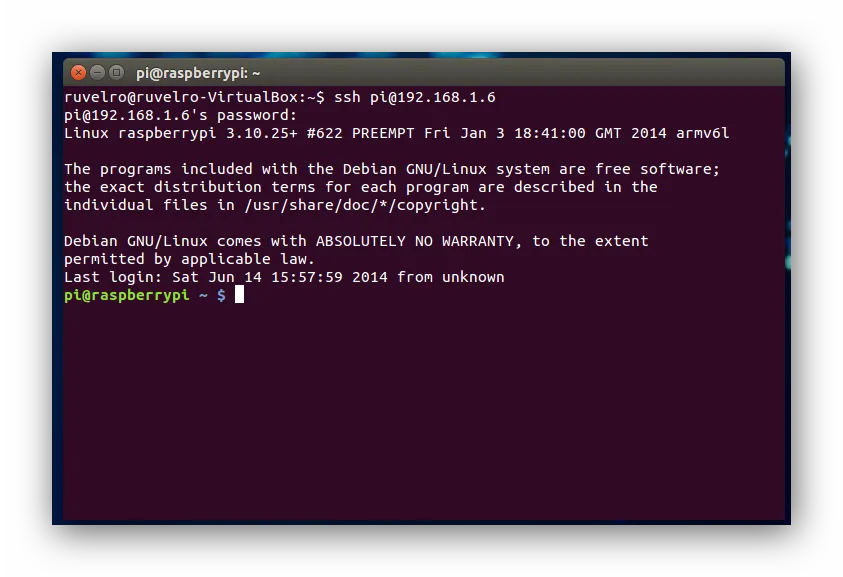

# Comprobar conectividad y SSH

Esta guía reúne tres formas de trabajar con Ubuntu Server en VirtualBox. El equipo físico puede servir para administrar el servidor por SSH y para comprobar sus servicios desde aplicaciones cliente, como un navegador.

## Formas de trabajar con Ubuntu Server

| Opción | Administración | Red y dirección que utiliza el cliente |
|---|---|---|
| 1. [Consola de VirtualBox](#consola-de-virtualbox) | Escribes los comandos en la ventana de Ubuntu Server. | Configura una red que permita las comunicaciones de la práctica. |
| 2. [Puente y SSH](#puente-y-ssh) | Abres una terminal en el equipo físico y conectas por SSH. | Un adaptador en puente con DHCP. Utiliza la IP que recibe el servidor en la red del aula. |
| 3. [NAT y Host-Only con SSH](#nat-y-host-only-con-ssh) | Conectas por SSH desde el equipo físico. | Dos adaptadores. NAT proporciona Internet y Host-Only comunica el anfitrión y la VM. Utiliza la IP Host-Only del servidor. |

Para la práctica 0502 se recomienda puente con DHCP y SSH, una vez comprobado que funciona en la red del aula. El anfitrión será también el cliente web.

## Preparar un clon nuevo

Al [crear el clon enlazado](./01_preparar_entorno_virtual.md#2-crear-un-clon-enlazado), solicita nuevas direcciones MAC. Completa el [primer arranque de un clon de Ubuntu Server](./01_preparar_entorno_virtual.md#primer-arranque-de-un-clon-de-ubuntu-server) para generar su identidad interna (`machine-id`) y sus claves de host SSH. Estas claves permiten reconocer al servidor cuando conectas por SSH.

La preparación de identidad se realiza una vez al crear cada clon. Conserva después ese clon como máquina de trabajo para la práctica.

## Antes de cambiar la red

Haz los cambios iniciales desde la consola de VirtualBox. Así mantienes el acceso al servidor mientras modificas su conexión.

1. Anota los adaptadores, sus modos de conexión y sus direcciones MAC.
2. Identifica las interfaces y los archivos de Netplan que las configuran.
3. Guarda una copia de cada archivo que vayas a modificar. Conserva las copias originales para poder recuperar la configuración anterior.

```bash
ip -br a
ip link show
ls /etc/netplan/
```

Sustituye `archivo-real.yaml` por el nombre del archivo identificado. La opción `-i` pide confirmación si ya existe la copia. Conserva esa copia original.

```bash
sudo cp -i /etc/netplan/archivo-real.yaml /etc/netplan/archivo-real.yaml.ORIGINAL
```

Consulta [Configurar la red en Ubuntu Server con Netplan](../UT01/tut/01_red_en_US.md) para editar y validar los archivos. Relaciona cada interfaz con el adaptador de VirtualBox mediante su MAC.

## Elegir la forma de trabajo

### Consola de VirtualBox

Arranca Ubuntu Server, inicia sesión y ejecuta los comandos directamente en su ventana. Puedes instalar paquetes y administrar Apache desde esa terminal.

Para instalar paquetes, configura una conexión con acceso a los repositorios. Para probar una web desde el navegador del equipo físico, utiliza una red que conecte ambos equipos, como puente o NAT junto con Host-Only. En esas pruebas emplea la IP del servidor que alcanza el cliente.

### Puente y SSH

1. Apaga Ubuntu Server y abre **Configuración → Red** en VirtualBox.
2. Selecciona **Adaptador puente**, elige la tarjeta física que tiene conexión a la red del aula y comprueba que **Cable conectado** está activado.
3. Arranca el servidor y localiza la interfaz correspondiente mediante su MAC.
4. Configura DHCP en esa interfaz siguiendo la guía de Netplan. Sustituye su configuración estática anterior por DHCP y conserva el resto del archivo.

Dentro de `ethernets`, el bloque de esa interfaz quedaría así. `enp0s3` es un ejemplo que debes sustituir por su nombre real.

```yaml
    enp0s3:
      dhcp4: true
```

Valida y confirma la configuración desde la consola.

```bash
sudo netplan try
ip -br a
ip route show
```

Comprueba la dirección recibida y la ruta de salida. Sigue el [apartado de SSH](#3-comprobar-ssh) para conectar desde el equipo físico.

Utiliza la IP de la interfaz puente para SSH y para acceder a los servicios. Si trabajas con nombres como `sitio1.local` y `sitio2.local`, asócialos a esa IP en el archivo `hosts` del equipo físico.

### NAT y Host-Only con SSH

Con la máquina apagada, prepara dos adaptadores según la guía [Red NAT y Host-Only](./03_red_nat_y_hostonly.md).

| Adaptador | Configuración | Función |
|---|---|---|
| NAT | DHCP, con puerta de enlace y DNS automáticos. | Acceder a los repositorios y a Internet. |
| Host-Only, solo anfitrión | Dirección estática de la red del laboratorio. | Comunicar el servidor con el equipo físico y las otras VM de esa red. |

La ruta predeterminada corresponde a NAT. La interfaz Host-Only utiliza su dirección y prefijo de red, con puerta de enlace y DNS en blanco. Usa una dirección disponible de la misma subred que el adaptador Host-Only del anfitrión, conforme al escenario.

La [guía de Netplan](../UT01/tut/01_red_en_US.md#3-ejemplo-para-ut01b-nat-y-host-only) contiene un ejemplo con las dos interfaces. Adapta sus nombres e IP a tu equipo y comprueba que solo hay una ruta predeterminada.

Desde el equipo físico, conecta por SSH a la **IP Host-Only** del servidor. Utiliza también esa dirección en su archivo `hosts` para los nombres de las webs de la práctica.

## 1. Interfaces y direcciones

Realiza las pruebas en orden. Si una comprobación falla, corrige ese nivel antes de continuar.

En Linux, tanto en el servidor como en el cliente cuando corresponda.

```bash
ip link show
ip addr show
ip route show
```

En PowerShell, en el equipo cliente Windows.

```powershell
Get-NetAdapter
ipconfig /all
route print
```

Comprueba que la interfaz está activa, la MAC es la esperada y la dirección pertenece a la subred del escenario.

## 2. Comunicación local

Haz `ping` a la IP del servidor desde el equipo físico o a otra máquina de la misma red.

```text
ping <IP-del-otro-equipo>
```

Fíjate en la dirección mostrada. Si el cortafuegos bloquea ICMP, comprueba también el acceso al servicio solicitado, como SSH o la web.

Una red interna o Host-Only sin router permite la comunicación local con direcciones de la misma subred. La puerta de enlace y el DNS se utilizan cuando el escenario los requiere. Consulta [Comprobar una red interna o Host-Only](../UT01/diagnostico_red_virtual.md) para interpretar las pruebas locales y de salida exterior.

## 3. Comprobar SSH

Comprueba su estado y la escucha en el puerto TCP 22.

```bash
sudo systemctl status ssh
sudo ss -lntp '( sport = :22 )'
```

En Ubuntu Server, instala OpenSSH Server si falta.

```bash
sudo apt update
sudo apt install openssh-server
```


En versiones de Ubuntu con activación por socket, `ssh.socket` puede estar escuchando y activar el servicio al llegar la primera conexión. Puedes comprobarlo con `sudo systemctl status ssh.socket`. Si el puerto 22 está escuchando, prueba la conexión desde el cliente. Si falta la escucha, inicia SSH con `sudo systemctl start ssh` y repite la comprobación.

Desde una terminal Linux o desde PowerShell en el equipo físico, sustituye los dos valores por tu cuenta de Ubuntu Server y la IP de la interfaz elegida.

```text
ssh <usuario>@<IP-del-servidor>
```



La primera conexión solicita confirmar la identidad del servidor. Compara la huella SHA-256 mostrada con la de su clave pública, consultada desde la consola de VirtualBox. Para una clave ED25519 puedes usar este comando. Compara el mismo tipo de clave en ambos equipos.

```bash
ssh-keygen -lf /etc/ssh/ssh_host_ed25519_key.pub -E sha256
```

Si coincide, acepta la conexión e introduce la contraseña de tu usuario de Ubuntu Server. Mientras la escribes, la terminal mantiene los caracteres ocultos.

Comprueba dónde estás ejecutando los comandos.

```bash
hostname
whoami
```

Con la sesión SSH abierta, las órdenes se ejecutan en Ubuntu Server. Para cerrar la conexión y volver a la terminal del equipo físico, ejecuta `exit`.

Si la conexión falla, comprueba la IP elegida, la escucha en TCP 22 y el cortafuegos. En NAT junto con Host-Only, el cliente utiliza la dirección Host-Only. En puente, utiliza la dirección recibida en la red del aula.

## 4. Salida exterior, solo si se solicita

Cuando el escenario incluya acceso a los repositorios o a Internet.

1. Comprueba la ruta predeterminada recibida por la interfaz NAT o puente.
2. Comprueba la resolución de un nombre exterior.
3. Prueba el acceso necesario para la práctica, por ejemplo `sudo apt update`.

Los resultados de las pruebas de servicio permiten comprobar el acceso aunque la red bloquee las respuestas al `ping`.

Consulta la explicación completa en [Comprobar una red interna o Host-Only](../UT01/diagnostico_red_virtual.md).
