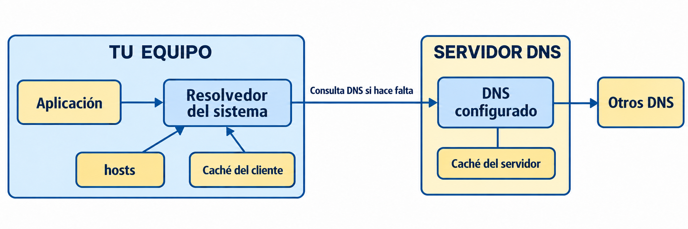
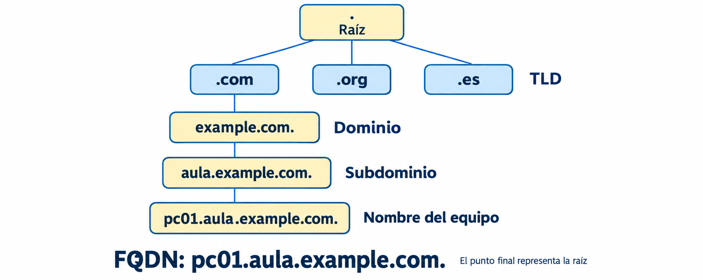

# Unidad de Trabajo 3: Servicios de Resolución de Nombres

Estos apuntes acompañan a la PPT y siguen el mismo recorrido. Los enunciados y las entregas se ofrecen desde Aula Virtual.

[Presentaciones del módulo en OneDrive](https://1drv.ms/f/c/FB7A28DA04B6A8F8/IgASJxvDbN3KSIyiZ-Jhjp08AbJ192nduQwU3GqtfNIDpG4?e=mrpNRK).

## Índice de actividades de enseñanza-aprendizaje

- [I. Introducción a DNS](#aea-i)
- [II. Resolución local: hosts](#aea-ii) · **0301 archivo hosts - DNS** (entrega opcional).
- [III. Consultas, respuestas y caché](#aea-iii)
- [IV. Consultas con nslookup](#aea-iv) · **0302 NSLOOKUP: comprueba DNS** (entrega opcional).
- [V. Jerarquía, FQDN y registros DNS](#aea-v) · **0303 FQDN (opcional)**.
- [VI. Windows: instalación y zona directa](#aea-vi) · **0304 Práctica DNS en Windows**, fase 1 de 4 (no obligatoria).
- [VII. Resolución inversa y correo](#aea-vii)
- [VIII. Windows: zona inversa y MX](#aea-viii) · **0304**, fase 2 de 4.
- [IX. Reenvío y caché del servidor](#aea-ix)
- [X. Windows: reenviador interno](#aea-x) · **0304**, fase 3 de 4.
- [XI. Windows: caché de nombres públicos](#aea-xi) · Reserva para la comprobación complementaria de la fase 3.
- [XII. Secundarios y transferencia](#aea-xii)
- [XIII. Windows: secundario en parejas](#aea-xiii) · **0304**, fase 4 de 4.
- [XIV. Revisión de la memoria DNS](#aea-xiv)
- [XV. Diagnóstico y ensayo](#aea-xv)
- [XVI. Repaso y dudas](#aea-xvi) · **0305 DNS con BIND9 (opcional)**.
- [XVII. Examen DNS](#aea-xvii)

<!-- Destinos de recursos de consulta que podrá completar el docente:
PPT específica de UT03 en OneDrive: href=""
Apuntes complementarios de caché pública: href=""
Apoyo al diagnóstico y ensayo: href=""
No añadir enlaces a enunciados, exámenes, soluciones ni guías privadas.
-->

<a id="aea-i"></a>
<a id="1-introducción"></a>
<a id="2-sistemas-de-nombres-planos"></a>
<a id="31-protocolo-dns"></a>

## I. Introducción a DNS

Recordamos mejor un nombre que una dirección IP. **DNS (Domain Name System)** permite consultar direcciones y otros datos asociados a los nombres, tanto en Internet como en redes privadas.

La jerarquía DNS organiza **nombres**. No representa la topología física de la red. DNS utiliza UDP y TCP, normalmente en el puerto 53. Los 512 bytes corresponden al límite original de mensajes DNS sobre UDP sin EDNS, no a un límite general actual.

Consulta: [introducción](./SR0301.md) y [contexto histórico de NetBIOS y WINS](./SR0302.md).

<a id="aea-ii"></a>
<a id="32-funcionamiento-del-dns"></a>
<a id="10-cliente-dns-resolver"></a>

## II. Resolución local: hosts

El **resolvedor del sistema** recibe la petición de una aplicación. Puede utilizar información local, como `hosts` y la caché del cliente, o consultar un servidor DNS. El orden concreto depende del sistema y de su configuración.



`hosts` asocia nombres e IP solo en el equipo donde se modifica. No crea registros en el servidor DNS. La caché del cliente y la del servidor son distintas.

Consulta: [cómo modificar hosts en Windows y Linux](./SR03_hosts.md#modificar-el-archivo-hosts-en-windows-y-linux) y [resolvedor y caché del cliente](./SR0310.md).

**0301 archivo hosts - DNS** · Entrega opcional.

<a id="aea-iii"></a>
<a id="4-consultas-dns"></a>
<a id="41-tipos-de-consultas"></a>
<a id="42-respuestas-dns"></a>
<a id="44-caché-dns"></a>

## III. Consultas, respuestas y caché

- **Recursiva**: se solicita una respuesta final o un error.
- **Iterativa**: el servidor devuelve lo que conoce, que puede ser una respuesta, un error o una referencia a otros DNS.
- **Respuesta autoritativa**: procede de un servidor que tiene autoridad para esa zona, primario o secundario.
- **Respuesta no autoritativa**: el servidor responde sin ser autoridad para ese nombre. Puede usar su caché o información obtenida de otros servidores.

Recursión y autoridad describen aspectos distintos. Una consulta iterativa también puede recibir una respuesta autoritativa.

La caché guarda información temporalmente según su **TTL**. No hay un orden universal de búsqueda «primario, secundario y caché». Un servidor autoritativo también puede responder que un nombre no existe.

Si `ping www.google.com` muestra una IP, se ha resuelto el nombre aunque no lleguen respuestas ICMP. Abrir una web en el navegador también puede desencadenar resolución, aunque pueden intervenir su propia caché o su configuración de DNS seguro.

Consulta: [consultas y respuestas](./SR0304.md), [recursión y autoridad](./SR0304+.md) y [cómo responde el servidor y cómo resuelve el cliente](./SR0303+.md).

<a id="aea-iv"></a>

## IV. Consultas con nslookup

`nslookup` consulta directamente a un servidor DNS. No comprueba el archivo `hosts` ni la caché del resolvedor del cliente.

```text
nslookup www.google.com
nslookup -type=MX google.com
```

En la salida, distingue el **servidor consultado y su IP**, que aparecen al principio, del **nombre y los datos de la respuesta**. Las direcciones y el idioma de la salida pueden variar. «No autoritativa» no significa que la respuesta sea incorrecta.

Consulta: [sintaxis, ejemplos e interpretación de nslookup](./SR0310.md#1031-nslookup).

**0302 NSLOOKUP: comprueba DNS** · Entrega opcional.

<a id="aea-v"></a>
<a id="3-sistemas-de-nombres-jerárquicos"></a>
<a id="33-estructura-de-dns"></a>
<a id="7-registros-dns"></a>
<a id="8-actualizaciones-dinámicas-ddns"></a>
<a id="9-dns-seguro-dnssec"></a>

## V. Jerarquía, FQDN y registros DNS

DNS forma un árbol cuya raíz se representa con `.`. Bajo ella están los TLD, como `.com`, `.org` o `.es`. Las 13 identidades raíz tienen numerosas instancias distribuidas, no son solo 13 máquinas.

Un **FQDN** identifica la posición completa de un nombre hasta la raíz. Puede nombrar un equipo, un dominio u otro recurso. En `pc01.aula.example.com.`, el punto final representa esa raíz.



| Registro | Función |
|---|---|
| SOA | Información administrativa de la zona y parámetros de sincronización. |
| NS | Nombre de un servidor autoritativo de la zona. |
| A / AAAA | Nombre asociado a una IPv4 / IPv6. |
| CNAME | Alias de otro nombre DNS. |
| MX | Servidor de correo y su preferencia. |
| PTR | Nombre asociado a una dirección en la resolución inversa. |
| SRV / TXT | Localización de servicios / datos de texto. |

Ejemplo didáctico:

```text
web.aula.test.      IN CNAME servidor.aula.test.
servidor.aula.test. IN A     192.0.2.10
```

Al resolver el alias se sigue el nombre de destino hasta obtener su dirección. Los nombres `.test` y las IP de documentación de estos ejemplos no sustituyen los datos de las guías del laboratorio.

**DDNS** permite actualizar registros automáticamente. **DNSSEC** utiliza firmas digitales para comprobar autenticidad e integridad de los datos DNS. No cifra las consultas ni oculta el nombre consultado.

Consulta: [jerarquía y FQDN](./SR0303.md), [registros DNS](./SR0307.md), [DDNS](./SR0308.md) y [DNSSEC](./SR0309.md). Los detalles de implantación de DDNS y DNSSEC son ampliación.

**0303 FQDN (opcional)**.

<a id="aea-vi"></a>

## VI. Windows: instalación y zona directa

**0304 Práctica DNS en Windows** · Fase 1 de 4 · No obligatoria.

Apuntes de apoyo: [zona DNS](./SR030601.md) y [registros SOA, NS, A y CNAME](./SR0307.md).

<a id="aea-vii"></a>
<a id="6-zonas-de-resolución-directa-e-inversa"></a>
<a id="45-resolución-inversa"></a>

## VII. Resolución inversa y correo

La zona directa y la inversa son zonas distintas. **PTR es un tipo de registro**, no un tipo de servidor. Para IPv4 se consulta un nombre bajo `in-addr.arpa`; para IPv6, bajo `ip6.arpa`.

Por ejemplo, la consulta inversa de `192.0.2.10` busca el PTR de `10.2.0.192.in-addr.arpa.`. Tener un registro A no crea automáticamente un PTR en otra zona.

Los registros MX indican servidores de correo. Un número de preferencia menor da mayor prioridad. Los controles de correo pueden utilizar PTR, pero este por sí solo no autentica al remitente ni determina siempre si un mensaje es spam.

Consulta: [resolución directa e inversa](./SR0306.md), [jerarquía inversa](./SR030602.md) y [registros MX y PTR](./SR0307.md).

<a id="aea-viii"></a>

## VIII. Windows: zona inversa y MX

**0304 Práctica DNS en Windows** · Fase 2 de 4.

<a id="aea-ix"></a>
<a id="46-delegación-y-reenvío-en-dns"></a>

## IX. Reenvío y caché del servidor

Una **delegación** indica mediante registros NS qué servidores tienen autoridad sobre una subzona. El resolvedor sigue esa referencia. Un **reenviador** recibe la consulta para resolverla por encargo de otro servidor.

La caché del servidor guarda respuestas obtenidas de otros DNS. Es independiente de la caché del cliente. La configuración determina si el servidor reenvía consultas, recorre la jerarquía o limita la recursión.

Consulta: [delegación, reenvío y sugerencias de raíz](./SR030401.md) y [caché del servidor](./SR0304.md#44-caché-dns).

<a id="aea-x"></a>

## X. Windows: reenviador interno

**0304 Práctica DNS en Windows** · Fase 3 de 4.

<a id="aea-xi"></a>

## XI. Windows: caché de nombres públicos

**0304 Práctica DNS en Windows** · Continuación de la fase 3.

Apartado reservado para la comprobación complementaria de la caché del servidor. Su enunciado se incorporará desde Aula Virtual cuando esté preparado.

<a id="aea-xii"></a>
<a id="5-tipos-de-servidores-dns"></a>
<a id="43-transferencia-de-zonas"></a>

## XII. Secundarios y transferencia

Primario y secundario son funciones **respecto a una zona**. Ambos pueden responder de forma autoritativa. Un servidor puede ser primario de una zona, secundario de otra y resolver otros nombres mediante recursión y caché.

La transferencia mantiene una copia de la misma zona en el secundario. Puede ser completa (**AXFR**) o incremental (**IXFR**). Transferir solo los cambios puede ahorrar tráfico; no aporta seguridad por ese hecho. Los parámetros del SOA y los avisos NOTIFY intervienen en la sincronización.

Consulta: [funciones de los servidores](./SR0305.md) y [transferencias de zona](./SR0304.md#43-transferencias-de-zona).

<a id="aea-xiii"></a>

## XIII. Windows: secundario en parejas

**0304 Práctica DNS en Windows** · Fase 4 de 4.

<a id="aea-xiv"></a>

## XIV. Revisión de la memoria DNS

**0304 Práctica DNS en Windows** · Revisión conjunta de las evidencias y explicaciones de la memoria.

<a id="aea-xv"></a>

## XV. Diagnóstico y ensayo

Relacionar cada consulta con su respuesta y localizar el origen de los fallos: configuración del cliente, registros, zonas, reenvío, caché o sincronización del secundario. Distinguir siempre la resolución DNS de la conectividad con el destino.

Consulta: [comprobaciones desde el cliente](./SR0310.md#105-resolución-de-problemas-con-el-resolver-dns).

<a id="aea-xvi"></a>

## XVI. Repaso y dudas

Repaso de conceptos y comprobaciones del laboratorio.

**0305 DNS con BIND9 (opcional)** · Ampliación para tiempo disponible o alumnado avanzado. La práctica guiada está pendiente de preparar. Los [ejemplos de sintaxis BIND9](./SR030401.md#ampliación-opcional-ejemplos-bind9) se ofrecen solo como consulta adicional.

`dig` y `host` también quedan como herramientas de ampliación: [consulta adicional](./SR0310bis.md). Instalar herramientas de cliente no exige instalar el servidor BIND9.

<a id="aea-xvii"></a>

## XVII. Examen DNS

30 preguntas tipo test y 4 ejercicios prácticos. La información de realización se comunica desde Aula Virtual y en clase.

<a id="más-información"></a>

## Referencias de consulta

- [RFC 1034: conceptos de DNS](https://www.rfc-editor.org/rfc/rfc1034.html).
- [Microsoft: nslookup](https://learn.microsoft.com/en-us/windows-server/administration/windows-commands/nslookup).
- [IANA: identidades raíz e instancias](https://www.iana.org/domains/root/servers).
- [Manuales de las herramientas de BIND](https://bind9.readthedocs.io/en/stable/manpages.html).
