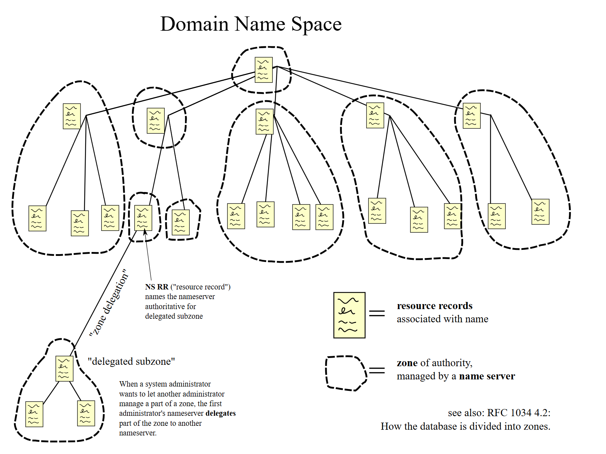

[DNS inicio](./SR03.md)

### **3. Sistemas de Nombres Jerárquicos**

A diferencia de los sistemas de nombres planos, los **sistemas de nombres jerárquicos** organizan los nombres de los dispositivos y recursos de manera estructurada, formando una jerarquía. Esta estructura facilita la gestión de nombres en redes de gran tamaño y ofrece una mayor flexibilidad y escalabilidad. El principal sistema de nombres jerárquico utilizado en Internet y en la mayoría de redes privadas es el **DNS (Domain Name System)**.

 [Public Domain](https://commons.wikimedia.org/w/index.php?curid=387678)

#### Características de los Sistemas de Nombres Jerárquicos:

1. **Estructura jerárquica**: Los nombres en estos sistemas están organizados en varios niveles o jerarquías. Cada nivel representa un dominio o subdominio, formando una estructura de árbol invertido, en la que los nodos superiores son los más generales y los inferiores los más específicos.
   
2. **Escalabilidad**: La naturaleza jerárquica permite que los sistemas de nombres jerárquicos escalen eficientemente a medida que las redes crecen en tamaño. Los dominios pueden dividirse en subdominios gestionados por diferentes entidades, permitiendo una gestión distribuida.

3. **Delegación**: La estructura jerárquica permite delegar partes del espacio de nombres a diferentes entidades. Por ejemplo, un dominio de nivel superior (TLD) como `.com` puede delegar la gestión de subdominios como `google.com` a Google.

---

### **3.1. Introducción al Protocolo DNS**

El **Domain Name System (DNS)** es el sistema jerárquico más utilizado para la resolución de nombres en Internet. DNS permite traducir nombres de dominio en direcciones IP, facilitando el acceso a los recursos de red sin que los usuarios tengan que recordar las direcciones IP numéricas.

Las primeras especificaciones de DNS se publicaron en 1983 (RFC 882 y 883); las RFC 1034 y 1035 consolidaron el protocolo en 1987. Antes se distribuía un archivo HOSTS.TXT, un método que no escalaba bien al crecer la red.

DNS utiliza UDP y TCP, normalmente en el puerto 53. TCP también se usa para consultas ordinarias cuando corresponde. 512 bytes era el límite original sobre UDP sin EDNS, no el máximo general del DNS actual.

##### 3.1.1. Funcionamiento Básico de DNS

DNS opera a través de una estructura jerárquica, donde cada nivel de la jerarquía está gestionado por una entidad diferente. Los servidores DNS contienen bases de datos que asocian nombres de dominio a direcciones IP y pueden reenviar consultas a otros servidores si no tienen la información solicitada.

Los servidores DNS pueden dividirse en varios tipos:
- **Servidores raíz**: Son los servidores más altos en la jerarquía DNS y gestionan las consultas iniciales sobre los dominios de nivel superior (TLD). Existen 13 identidades raíz, de A a M, con numerosas instancias distribuidas. No son solo 13 máquinas físicas.
- **Servidores TLD (Top Level Domain)**: Estos servidores gestionan los dominios de nivel superior, como `.com`, `.org`, `.es`, etc.
- **Servidores autoritativos**: Estos son los servidores responsables de gestionar la resolución de nombres en un dominio específico, como `google.com`.

---

### **3.2. Funcionamiento Detallado del Protocolo DNS**

#### 3.2.2. Estructura Jerárquica de DNS

DNS utiliza una estructura jerárquica y distribuida. El sistema se organiza como un **árbol invertido**, donde:
- La **raíz** del árbol está representada por el carácter “.” (punto). Esta es gestionada por los **servidores raíz**.
- Justo debajo de la raíz se encuentran los **dominios de nivel superior (TLD)**, que incluyen:
  - **Dominios genéricos** (gTLD): como `.com`, `.org`, `.net`.
  - **Dominios geográficos** (ccTLD): como `.es` para España, `.uk` para Reino Unido.

Cada dominio puede tener múltiples **subdominios**. Solo se administran como zonas independientes cuando se delegan; también pueden seguir dentro de la zona padre. Por ejemplo, `google.com` es un subdominio de `.com`, y `mail.google.com` es un subdominio de `google.com`.

 By <a href="//commons.wikimedia.org/w/index.php?title=User:Jane_Kruch&amp;action=edit&amp;redlink=1" class="new" title="User:Jane Kruch (page does not exist)">Jane Kruch</a> - Own work, <a href="https://creativecommons.org/licenses/by-sa/3.0" title="Creative Commons Attribution-Share Alike 3.0">CC BY-SA 3.0</a>, <a href="https://commons.wikimedia.org/w/index.php?curid=30106365">Link</a>

#### 3.2.3. Espacio de Nombres

El **espacio de nombres** define cómo se organizan los nombres DNS en niveles. Un **FQDN (Fully Qualified Domain Name)** es un nombre absoluto que incluye todas las etiquetas hasta la raíz. No tiene que identificar necesariamente un host: también puede nombrar un dominio u otro recurso.

En `pc01.aula.example.com.`, `pc01` identifica el equipo del ejemplo y el resto sitúa el nombre dentro de la jerarquía. El punto final representa la raíz.

Cada etiqueta admite hasta 63 octetos y el nombre completo hasta 255 octetos en su representación DNS, incluidos los campos de longitud y la raíz. No equivale a 255 caracteres visibles. Las letras ASCII no distinguen mayúsculas de minúsculas.

#### 3.2.4. Zonas DNS y Transferencias [+](./SR0303+.md)

El espacio de nombres en DNS se divide en **zonas**, que son porciones del árbol DNS gestionadas por un servidor autoritativo. Una **zona** puede abarcar uno o varios subdominios.

La información de una zona se almacena en un servidor primario (maestro) y puede replicarse en uno o más servidores secundarios (esclavos) para redundancia y equilibrio de carga. Para mantener la coherencia entre los servidores primario y secundario, se utilizan **transferencias de zona**. Estas transferencias pueden ser:
- **Transferencia completa (AXFR)**: Copia todo el contenido de la zona.
- **Transferencia incremental (IXFR)**: Solo copia los cambios desde la última transferencia.

---

### Referencias de consulta

- [RFC 882: primera especificación de DNS](https://www.rfc-editor.org/rfc/rfc882.html).
- [RFC 1035: límites de los nombres](https://www.rfc-editor.org/rfc/rfc1035.html).
- [RFC 7766: DNS sobre TCP](https://www.rfc-editor.org/rfc/rfc7766.html).
- [IANA: servicio raíz](https://www.iana.org/domains/root/servers).
